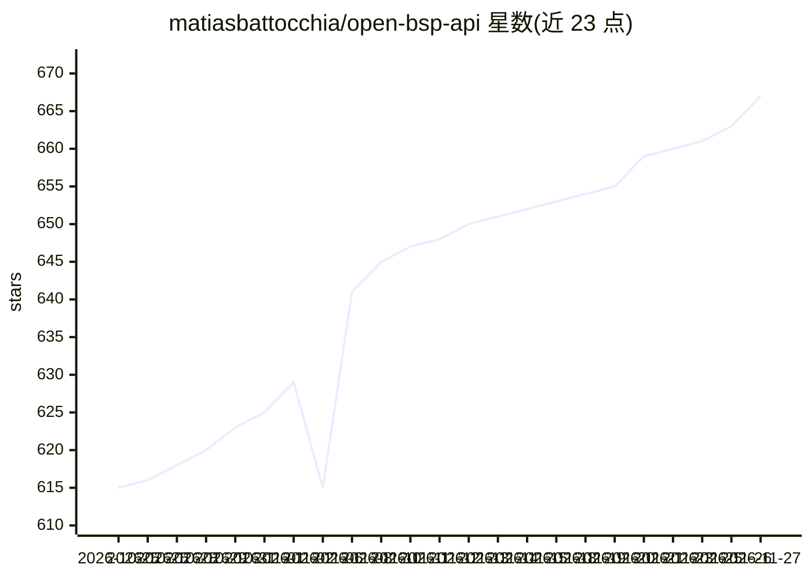

# matiasbattocchia/open-bsp-api

⭐ 667 · TypeScript · Unlicense · 推送 2026-11-26 · [GitHub](https://github.com/matiasbattocchia/open-bsp-api) · [官网](https://web.openbsp.dev) · 个人维护

**自托管的多租户 WhatsApp/Instagram/TikTok 消息 API 平台**

OpenBSP API 是一个用 Deno 与 Postgres（Supabase）构建的开源消息平台：通过官方 WhatsApp、Instagram API 收发消息并存入数据库，支持多租户组织隔离、webhook 与 REST/Supabase SDK 接入。提供轻量内置 agent（带 MCP/SQL/HTTP 客户端等工具）、媒体内容解析、MCP server（OAuth 或 API key 认证）及 Claude Code 插件，让 Claude、ChatGPT、Cursor 等 MCP 客户端读写消息。面向自用商家或转型 Meta Business Partner 的服务商，另有按消息量分级的托管版本。

## 筛选速览

| 维度 | 判定 | 备注 |
|---|---|---|
| AI 角色 | `ai-enhanced` | 去掉 AI 部分产品仍成立 |
| 许可风险 | `permissive` | Unlicense |
| 部署形态 | `library` | 以包/库形式分发 |
| 模型依赖 | — | README 未给出锁定关系 |
| 硬件要求 | — | 无带数字的原话,不猜 |
| 安装摩擦 | `low` | 无编译、无系统依赖或容器化 |
| 成熟度 | — | 结构信号不足 |

## 能力要点

- 每张表即一个端点：PostgREST 风格 API，webhook 推送原始消息行
- MCP server 暴露 status/inbox/reply/query/change 等 9+ 工具，支持 OAuth 2.1 与 API key 两种认证
- 内置轻量 agent 及 chat-completions/responses 协议接入外部 agent
- 附 Claude Code 插件与官方 n8n 社区节点包

## 适用场景

- 自托管管理 WhatsApp/Instagram 商家消息收发
- 在 n8n 工作流中触发消息事件并让 AI 节点带历史回复
- 让 Claude Code/ChatGPT 等 MCP 客户端代收代回复消息
- 从 Twilio 或 whatsapp-web.js 迁移到官方 WhatsApp Business API

## 场景标签

`聊天机器人` · 领域:对话与助手

## 证据(README 行号)

> L5:  Self-hostable, multi-tenant, AI-agent ready. Built with Deno 🦕 and Postgres 🐘, powered by Supabase ⚡
> L140: OpenBSP API is a multi-tenant platform that connects to the official WhatsApp
> L169: > This project prioritizes a decoupled architecture between communication and

## 星数曲线

2026-10-25 615 → 2026-11-27 667（+52）

---
*卡片 v1 · prompt 1.4 · 生成 2026-11-27 · 置信度 high · 依据 README sha `c2a0c3a2119d` · [字段定义](../../DATASET.md)*
