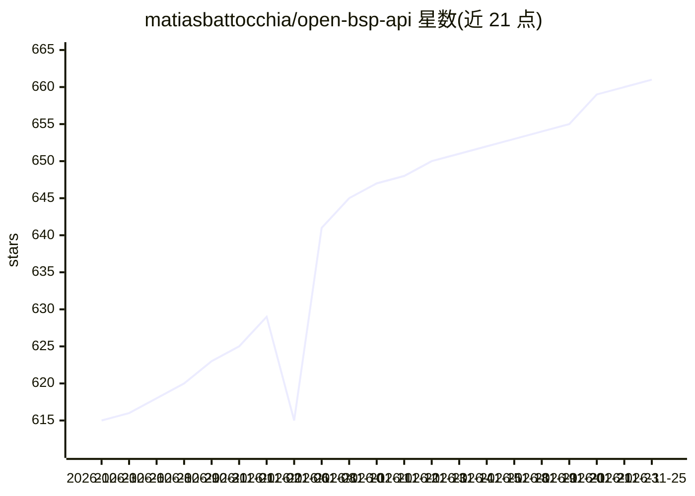

# matiasbattocchia/open-bsp-api

⭐ 661 · TypeScript · Unlicense · 推送 2026-11-03 · [GitHub](https://github.com/matiasbattocchia/open-bsp-api) · [官网](https://web.openbsp.dev) · 个人维护

**给企业的多租户 WhatsApp/Instagram 消息自托管 API 平台**

OpenBSP API 是一个可自托管的多租户平台，通过官方 WhatsApp 与 Instagram API 收发消息并存入 Supabase 数据库；每张表经 PostgREST 即为端点，支持 REST 或各语言 Supabase SDK 调用。内置轻量级 AI agent（含 MCP/SQL/HTTP 客户端等工具），并提供 MCP server 让 Claude Code、Claude Desktop、ChatGPT 等 agentic 客户端操作 WhatsApp API。支持 webhook 外部集成、n8n 节点、Claude Code 插件；自托管通过 fork 仓库加 Supabase GitHub Integration 或 GitHub Actions 部署。

## 筛选速览

| 维度 | 判定 | 备注 |
|---|---|---|
| AI 角色 | `ai-ecosystem` | LLM/agent 周边工具 |
| 许可风险 | `permissive` | Unlicense |
| 部署形态 | `library` | 以包/库形式分发 |
| 模型依赖 | — | README 未给出锁定关系 |
| 硬件要求 | — | 无带数字的原话,不猜 |
| 安装摩擦 | `low` | 无编译、无系统依赖或容器化 |
| 成熟度 | — | 结构信号不足 |

## 能力要点

- 多租户架构，支持多个组织隔离环境
- 每张数据库表经 PostgREST 即为 REST 端点，webhook 推送每条新消息
- 内置 MCP server（Streamable HTTP），提供 list_accounts/send_message 等 7 个工具，支持 OAuth 与 API key 认证
- AI agent 支持 chat-completions/responses 协议接入外部 agent

## 适用场景

- 自托管管理企业和客户的 WhatsApp/Instagram 消息
- 通过 n8n 或 webhook 让 AI 节点带上下文自动回复消息
- 让 Claude Code 直接读取和回复 WhatsApp/Instagram 消息
- 从 Twilio 或 whatsapp-web.js 迁移到官方 Cloud API

## 场景标签

 · 领域:通信/消息平台

## 证据(README 行号)

> L136: OpenBSP API is a multi-tenant platform that connects to the official WhatsApp
> L181: The `mcp` Edge Function exposes an MCP server
> L154: Create lightweight agents or connect to external, more advanced agents using

## 星数曲线

2026-10-23 615 → 2026-11-25 661（+46）

---
*卡片 v1 · prompt 1.4 · 生成 2026-11-24 · 置信度 high · 依据 README sha `84a3412d55f3` · [字段定义](../../DATASET.md)*
