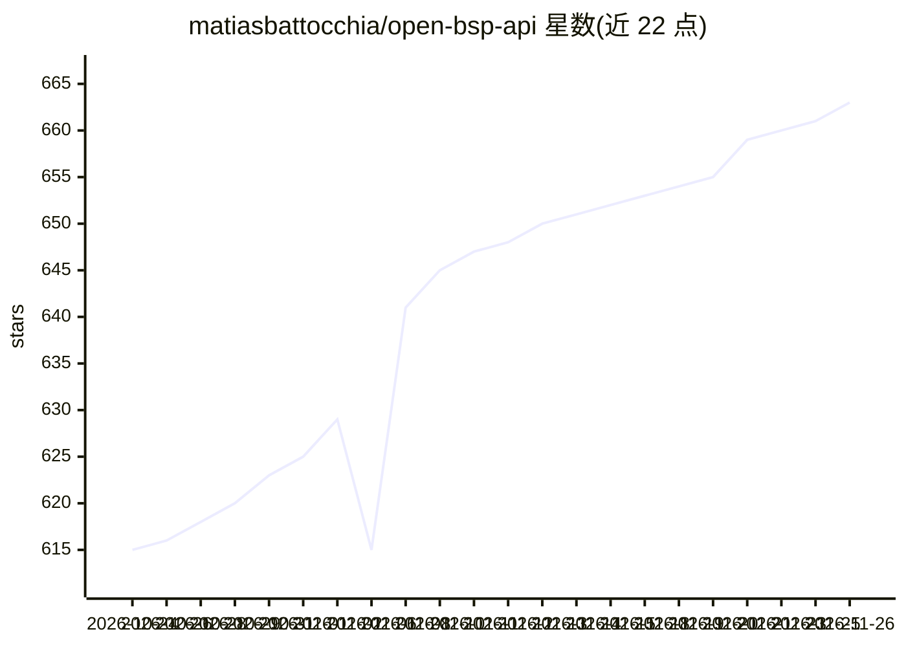

# matiasbattocchia/open-bsp-api

⭐ 663 · TypeScript · Unlicense · 推送 2026-11-25 · [GitHub](https://github.com/matiasbattocchia/open-bsp-api) · [官网](https://web.openbsp.dev) · 个人维护

**自托管多租户 WhatsApp/Instagram 消息平台 API，供企业与 AI 代理收发消息**

基于 Deno 与 Postgres（Supabase）的开源消息平台 API，连接 WhatsApp、Instagram（及 TikTok、Slack）官方接口收发消息，数据存入 Supabase 数据库；API 为数据库之上的 PostgREST，每张表即端点，配合 webhook 与 Supabase SDK 使用。支持多租户组织隔离、Embedded Signup 接入既有 WhatsApp Business 账号、内建轻量代理（MCP/SQL/HTTP 客户端等工具）或外接代理，并暴露 MCP server 供 Claude Code 等客户端读写会话。提供托管版本（Free 至 Business 计划），含数据导出与级联删除机制。

## 筛选速览

| 维度 | 判定 | 备注 |
|---|---|---|
| AI 角色 | `ai-enhanced` | 去掉 AI 部分产品仍成立 |
| 许可风险 | `permissive` | Unlicense |
| 部署形态 | `library` | 以包/库形式分发 |
| 模型依赖 | — | README 未给出锁定关系 |
| 硬件要求 | — | 无带数字的原话,不猜 |
| 安装摩擦 | `low` | 无编译、无系统依赖或容器化 |
| 成熟度 | — | 结构信号不足 |

## 能力要点

- PostgREST 形态的 API：每张数据库表即 REST 端点
- webhook 事件携带完整会话上下文，可与 n8n AI 节点配合
- 内建 MCP server（Streamable HTTP），支持 OAuth 2.1 与 API key 两种认证
- 轻量代理可使用 MCP/SQL/HTTP 客户端、计算器等内建工具

## 适用场景

- 自托管管理 WhatsApp/Instagram 的客服消息收发
- 通过 n8n 或 MCP 客户端让 AI 自动回复客户消息
- 向其他组织提供消息服务，转型 Meta 官方 Solution Provider
- 从 Twilio 或 whatsapp-web.js 迁移现有 WhatsApp 集成

## 场景标签

 · 领域:通信/消息平台

## 证据(README 行号)

> L140: OpenBSP API is a multi-tenant platform that connects to the official WhatsApp
> L156: ### AI agents
> L185: The `mcp` Edge Function exposes an MCP server

## 星数曲线

2026-10-24 615 → 2026-11-26 663（+48）

---
*卡片 v1 · prompt 1.4 · 生成 2026-11-26 · 置信度 mid · 依据 README sha `7bb450d2d3ae` · [字段定义](../../DATASET.md)*
