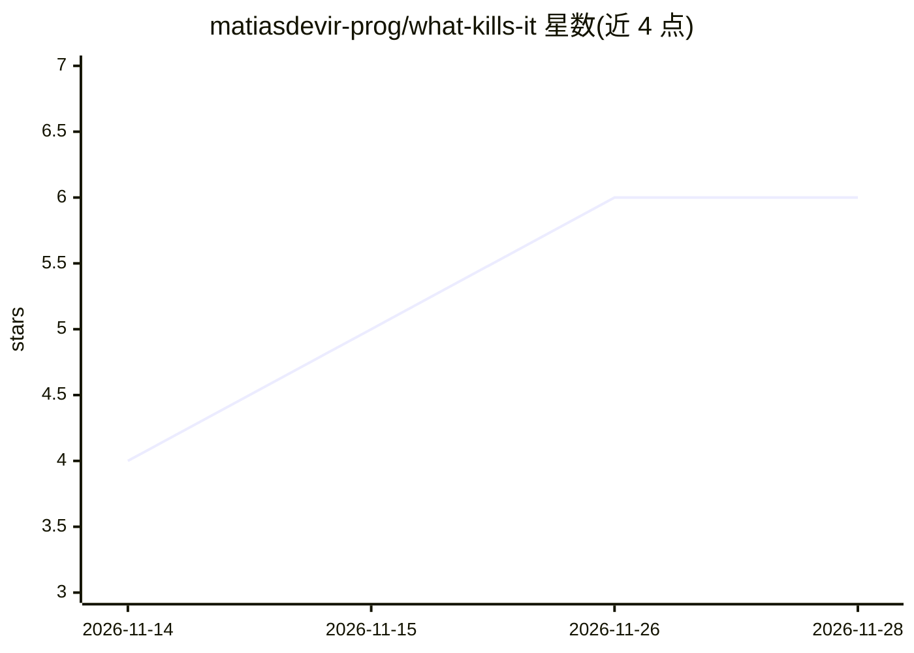

# matiasdevir-prog/what-kills-it

⭐ 6 · MIT · 推送 2026-10-30 · [GitHub](https://github.com/matiasdevir-prog/what-kills-it) · 个人维护

**给创作者用 Claude 技能在动工前拷问计划与点子的漏洞**

一个以 SKILL.md 形式分发的 Claude 技能，通过六步访谈式拷问（钉死目标、找漏洞、设定诚实的度量、命名致命失败点、设计最便宜验证实验、给出 Go/No-go/Fix-first 裁决）对用户的计划、想法、规格或代码做批判性审查，强调预先冻结指标与单一诚实数字。双语文本：引擎为英文，可按用户所用语言回复。安装方式为桌面应用保存技能文件，或将 SKILL.md 复制到技能目录。MIT 许可，个人维护。

## 筛选速览

| 维度 | 判定 | 备注 |
|---|---|---|
| AI 角色 | `ai-native` | 本体是模型或模型工具 |
| 许可风险 | `permissive` | MIT |
| 部署形态 | `None` |  |
| 模型依赖 | locked-api |  |
| 硬件要求 | — | 无带数字的原话,不猜 |
| 安装摩擦 | `low` | 无编译、无系统依赖或容器化 |
| 成熟度 | — | 结构信号不足 |

## 能力要点

- 六步访谈流程产出 Go / No-go / Fix-first 一行裁决
- 要求预先冻结指标、设基线、算净成本的诚实度量机制
- 英/西等双语回复：英文引擎，按用户语言作答
- 以 SKILL.md 文件分发，支持 Claude 桌面应用与手动安装

## 适用场景

- 动工前让 AI 找出我的产品计划里的隐藏成本与未声明假设
- 为项目确定一个事先同意的诚实成功指标和基线
- 设计一天内能证明或证伪最大风险的最低成本实验

## 场景标签

`提示工程` · 领域:Agent 开发

## 证据(README 行号)

> L3: A **Claude skill** that grills your plan, idea, strategy, spec, or code **before you build it**.
> L18: 6. **Verdict.** Go / No-go / Fix-first, in one line. No false encouragement.

## 星数曲线

2026-11-14 4 → 2026-11-28 6（+2）

---
*卡片 v1 · prompt 1.4 · 生成 2026-11-21 · 置信度 high · 依据 README sha `6181aa72e76d` · [字段定义](../../DATASET.md)*
