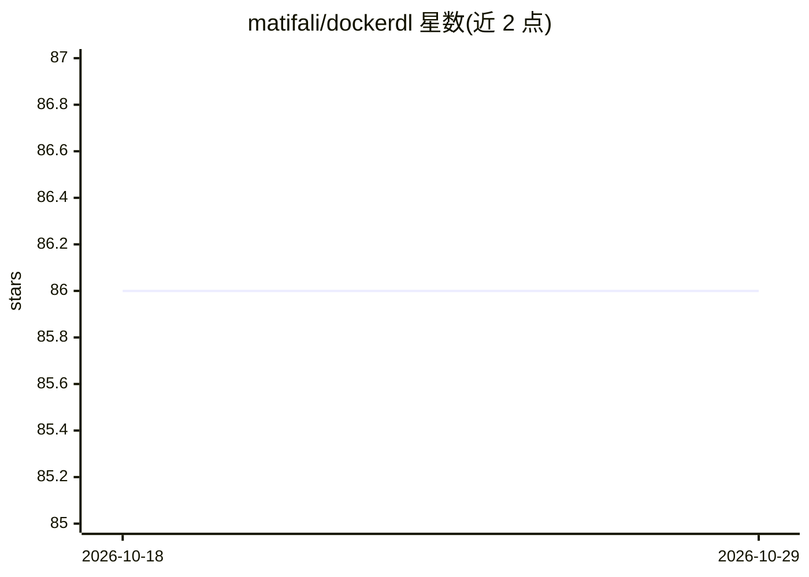

# matifali/dockerdl

⭐ 86 · Dockerfile · MIT · 推送 2026-09-13 · [GitHub](https://github.com/matifali/dockerdl) · [官网](https://hub.docker.com/r/matifali/dockerdl) · 个人维护

**预装深度学习环境的 Docker 镜像，免去自行搭建**

提供预装 JupyterLab、PyTorch、TensorFlow 及常用科学计算库（NumPy/Pandas/Scikit-Learn 等）的 Docker 镜像，有 tf、torch、tf-torch 三种变体，基于 uv 管理的 Python 3.13 与 Ubuntu 26.04。CUDA 12.6 与 cuDNN 来自 pip wheel，宿主机仅需支持 CUDA 12 的 NVIDIA 驱动。面向需要快速获得 GPU 深度学习环境的开发者，通过 docker run 或 VS Code/Coder/PyCharm 远程连接使用，支持克隆仓库自定义构建。conda 系列标签已停止构建。

## 筛选速览

| 维度 | 判定 | 备注 |
|---|---|---|
| AI 角色 | `ai-ecosystem` | LLM/agent 周边工具 |
| 许可风险 | `permissive` | MIT |
| 部署形态 | `self-host` | docker 或自建部署 |
| 模型依赖 | — | README 未给出锁定关系 |
| 硬件要求 | — | 无带数字的原话,不猜 |
| 安装摩擦 | `low` | 无编译、无系统依赖或容器化 |
| 成熟度 | — | 结构信号不足 |

## 能力要点

- 三种镜像变体：tf / torch / tf-torch
- CUDA 12.6 与 cuDNN 内置于 pip wheel，宿主机仅要求 NVIDIA 驱动 >= 525
- 内置 JupyterLab、uv、zellij 等工具链
- 支持克隆仓库修改 Dockerfile 自定义构建

## 适用场景

- 一条命令获得带 GPU 的深度学习开发环境
- 通过 VS Code / Coder / PyCharm 远程连接容器做模型开发
- 按需定制包含指定包的团队基础镜像

## 场景标签

 · 领域:深度学习/开发环境

## 证据(README 行号)

> L5: ## Deep Learning Docker Image
> L7: Don't waste time on setting up a deep learning environment while you can get a deep learning environment with everyt

## 星数曲线

2026-10-18 86 → 2026-10-29 86（+0）

---
*卡片 v1 · prompt 1.4 · 生成 2026-10-24 · 置信度 mid · 依据 README sha `0b56f6fd01fb` · [字段定义](../../DATASET.md)*
