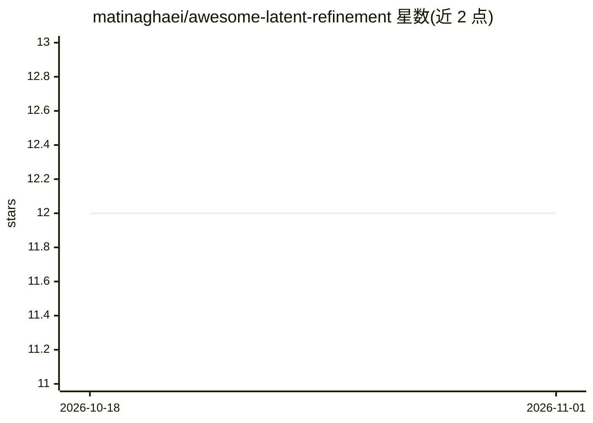

# matinaghaei/awesome-latent-refinement

⭐ 12 · CC0-1.0 · 推送 2026-05-11 · [GitHub](https://github.com/matinaghaei/awesome-latent-refinement) · 个人维护

**隐空间迭代精炼（latent refinement）研究论文策展清单**

面向研究者的 awesome 类论文清单，收录通过迭代更新内部潜在表示（而非显式中间输出）来提升推理与规划的模型和 agent 研究。内容分为监督隐空间精炼（专用推理器、循环语言模型、视觉-语言-动作模型）与强化学习隐空间精炼（无模型规划、循环推理 agent、RL 中的计算）两大类，并明确排除文本自精炼、树搜索、显式世界模型规划等方法。条目附 arXiv/代码/网站链接，设有三条收录标准（推理时隐状态迭代精炼、共享或循环计算、内部算力增加带来性能提升），采用 CC0 许可。

## 筛选速览

| 维度 | 判定 | 备注 |
|---|---|---|
| AI 角色 | `ai-knowledge` | 知识聚合/清单类 |
| 许可风险 | `viral` | CC0-1.0 |
| 部署形态 | `None` |  |
| 模型依赖 | — | README 未给出锁定关系 |
| 硬件要求 | — | 无带数字的原话,不猜 |
| 安装摩擦 | `low` | 无编译、无系统依赖或容器化 |
| 成熟度 | — | 结构信号不足 |

## 能力要点

- 按监督学习与强化学习两大类组织隐空间迭代精炼研究
- 明确列出收录标准与排除范围（排除树搜索、文本自精炼、显式世界模型规划）
- 每条目提供 arXiv/代码/网站等资源链接
- 附相关 awesome 清单（latent CoT、implicit reasoning、inference-time scaling 等）

## 适用场景

- 查找循环/递归深度语言模型的推理研究论文
- 追踪通过增加推理时内部计算提升性能的方法
- 了解隐空间规划与循环推理 agent 的研究脉络

## 场景标签

`精选清单` · 领域:学习与行业

## 证据(README 行号)

> L29: - organize research on **iterative refinement of latent state**
> L31: - track systems where **additional inference-time compute improves performance**
> L156: 1. **Iterative refinement of latent state** at inference time

## 星数曲线

2026-10-18 12 → 2026-11-01 12（+0）

---
*卡片 v1 · prompt 1.4 · 生成 2026-11-01 · 置信度 high · 依据 README sha `bc32e29afea0` · [字段定义](../../DATASET.md)*
