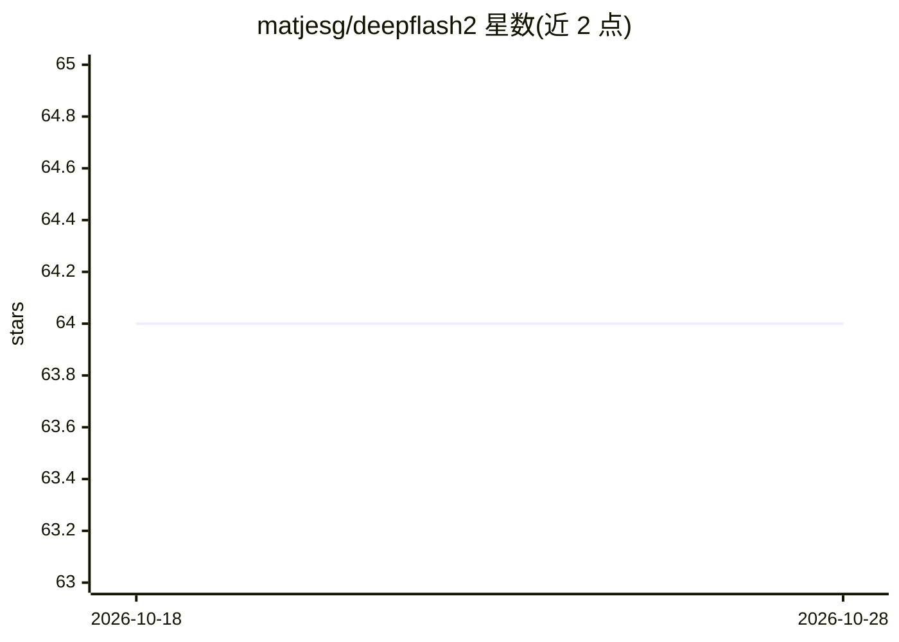

# matjesg/deepflash2

⭐ 64 · Jupyter Notebook · Apache-2.0 · 推送 2026-08-03 · [GitHub](https://github.com/matjesg/deepflash2) · [官网](https://matjesg.github.io/deepflash2/) · 组织维护

**生命科学研究者的显微图像深度学习分割流程**

面向无需编程的生命科学研究者的显微图像分割流程：提供图形界面（Jupyter 内运行的 Web GUI）与独立 Python API。功能覆盖多专家标注的 Ground Truth 估计（STAPLE/多数投票）、集成训练与验证、语义与实例分割预测及不确定性图，并含质量保障与分布外检测。实例分割补充使用 cellpose v0.6.6.dev13+g316927e。可在 Google Colab、本地（Windows/Linux/Mac x86-64，推荐 GPU）或 Docker 中运行。

## 筛选速览

| 维度 | 判定 | 备注 |
|---|---|---|
| AI 角色 | `ai-native` | 本体是模型或模型工具 |
| 许可风险 | `permissive` | Apache-2.0 |
| 部署形态 | `self-host` | docker 或自建部署 |
| 模型依赖 | — | README 未给出锁定关系 |
| 硬件要求 | `gpu-8g` | |
| 安装摩擦 | `low` | 无编译、无系统依赖或容器化 |
| 成熟度 | — | 结构信号不足 |

## 能力要点

- 多专家标注的 Ground Truth 估计（STAPLE/多数投票）
- 集成训练与语义/实例分割预测，输出不确定性图
- 质量保障与分布外（OOD）检测
- 无需编程的 GUI（Jupyter Web 应用）与独立 Python API

## 适用场景

- 显微图像的语义与实例分割标注产出
- 从多名专家标注生成训练用真值掩码
- 在 Colab 上用样例数据快速试用分割流程

## 场景标签

`目标检测` · 领域:感知与多模态

## 证据(README 行号)

> L5: Official repository of deepflash2 - a deep-learning pipeline for segmentation of ambiguous microscopic images.
> L16: - **Ground truth estimation** from the annotations of multiple experts for model training and validation
> L48: |Main Task|STAPLE or Majority Voting|Ensemble training and validation|Semantic and instance segmentation|

## 星数曲线

2026-10-18 64 → 2026-10-28 64（+0）

---
*卡片 v1 · prompt 1.4 · 生成 2026-10-24 · 置信度 mid · 依据 README sha `1a9c8980841f` · [字段定义](../../DATASET.md)*
