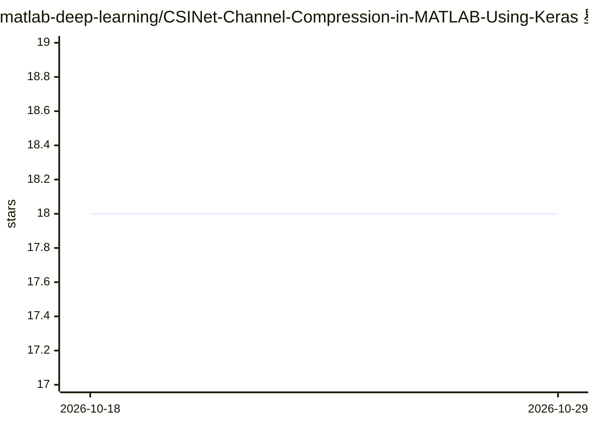

# matlab-deep-learning/CSINet-Channel-Compression-in-MATLAB-Using-Keras

⭐ 18 · MATLAB · NOASSERTION · 推送 2026-09-16 · [GitHub](https://github.com/matlab-deep-learning/CSINet-Channel-Compression-in-MATLAB-Using-Keras) · [官网](https://www.mathworks.com/products/communications.html) · 组织维护

**MATLAB+Keras 联合执行示例：CSINet 信道压缩对 MIMO 预编码的影响仿真**

MathWorks 官方示例，演示 MATLAB 与 Python 共同执行的工作流：用 5G Toolbox 生成 CDL 信道估计，加载预训练 CSINet Keras 模型测试，通过迁移学习微调权重，并在 5G Toolbox 与 Communications Toolbox 中仿真信道估计压缩对零迫预编码接收星座图的影响。面向需要在 MATLAB 端到端链路仿真中测试其他框架深度学习模型的无线工程团队。运行需 MATLAB R2022b 及多个工具箱、Python 与 TensorFlow/Keras。

## 筛选速览

| 维度 | 判定 | 备注 |
|---|---|---|
| AI 角色 | `ai-knowledge` | 知识聚合/清单类 |
| 许可风险 | `none` | NOASSERTION |
| 部署形态 | `None` |  |
| 模型依赖 | — | README 未给出锁定关系 |
| 硬件要求 | — | 无带数字的原话,不猜 |
| 安装摩擦 | `low` | 无编译、无系统依赖或容器化 |
| 成熟度 | — | 结构信号不足 |

## 能力要点

- MATLAB 与 Python/Keras 共同执行深度学习模型
- CSINet 信道反馈压缩仿真（压缩率 1/4，NMSE -42 dB）
- 支持迁移学习微调预训练模型权重
- 可视化压缩对 OFDM MIMO 零迫预编码星座图的影响

## 适用场景

- 在 MATLAB 链路仿真中测试 Keras 深度学习模型
- 结合 MATLAB 无线工具箱与 Python 团队的工作
- 研究 CSI 压缩对 MIMO OFDM 预编码性能的影响

## 场景标签

`教程课程` · 领域:学习与行业

## 证据(README 行号)

> L3: This example shows how to co-execute MATLAB&reg; and Python&reg; to simulate the effect of channel estimate compress
> L19: This example provides an overview of the third approach. Co-execution is useful for leveraging wireless products in

## 星数曲线

2026-10-18 18 → 2026-10-29 18（+0）

---
*卡片 v1 · prompt 1.4 · 生成 2026-10-29 · 置信度 high · 依据 README sha `33eaf7d46191` · [字段定义](../../DATASET.md)*
