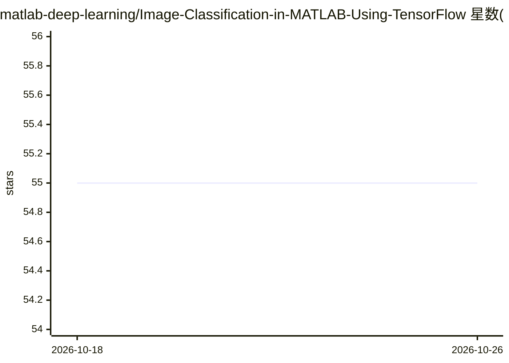

# matlab-deep-learning/Image-Classification-in-MATLAB-Using-TensorFlow

⭐ 55 · MATLAB · NOASSERTION · 推送 2026-01-22 · [GitHub](https://github.com/matlab-deep-learning/Image-Classification-in-MATLAB-Using-TensorFlow) · [官网](https://www.mathworks.com/solutions/deep-learning.html) · 组织维护

**MathWorks 示例：在 MATLAB 中协同调用 TensorFlow 预训练模型做图像分类**

MathWorks 官方示例仓库，演示通过 Python 协同执行（co-execution）在 MATLAB 中调用 TensorFlow 预训练图像分类模型。提供两条工作流：Live Editor task for Python 嵌入 Python 代码，以及直接用 MATLAB 命令（py.tensorflow...）加载 EfficientNetV2L 并分类图片。文档说明 MATLAB 与 TensorFlow 数据类型映射（HWCN→NHWC）、性能开销与嵌入式代码生成不可用等限制。要求 MATLAB R2021b+、TensorFlow 2.8、Python 3.8+ 且同机安装。

## 筛选速览

| 维度 | 判定 | 备注 |
|---|---|---|
| AI 角色 | `ai-knowledge` | 知识聚合/清单类 |
| 许可风险 | `none` | NOASSERTION |
| 部署形态 | `None` |  |
| 模型依赖 | — | README 未给出锁定关系 |
| 硬件要求 | — | 无带数字的原话,不猜 |
| 安装摩擦 | `medium` | 含编译或系统依赖之一 |
| 成熟度 | — | 结构信号不足 |

## 能力要点

- 两条工作流：Live Editor task 与 MATLAB 命令直接调用 TensorFlow 模型
- 加载 tensorflow.keras.applications 预训练模型（EfficientNetV2L）完成图像分类
- 说明数据类型转换（HWCN→NHWC、int32）与限制（延迟、嵌入式代码生成不可用）
- 附 MATLAB 内三种模型接入方式的对比表

## 适用场景

- MATLAB 用户复用 TensorFlow 预训练模型处理图像
- 多框架团队在同一应用中组合 MATLAB 前后处理与 TensorFlow 模型
- 学习 MATLAB 调用 Python/TensorFlow 的协同执行方法

## 场景标签

`目标检测` `教程课程` · 领域:学习与行业

## 证据(README 行号)

> L3: ### This example shows how to call a TensorFlow&trade; model from MATLAB&reg; using co-execution with Python&reg;.
> L17: Co-execution between MATLAB and TensorFlow is when both frameworks are used together, in executing a single applica

## 星数曲线

2026-10-18 55 → 2026-10-26 55（+0）

---
*卡片 v1 · prompt 1.4 · 生成 2026-10-24 · 置信度 high · 依据 README sha `d5b719c6a040` · [字段定义](../../DATASET.md)*
