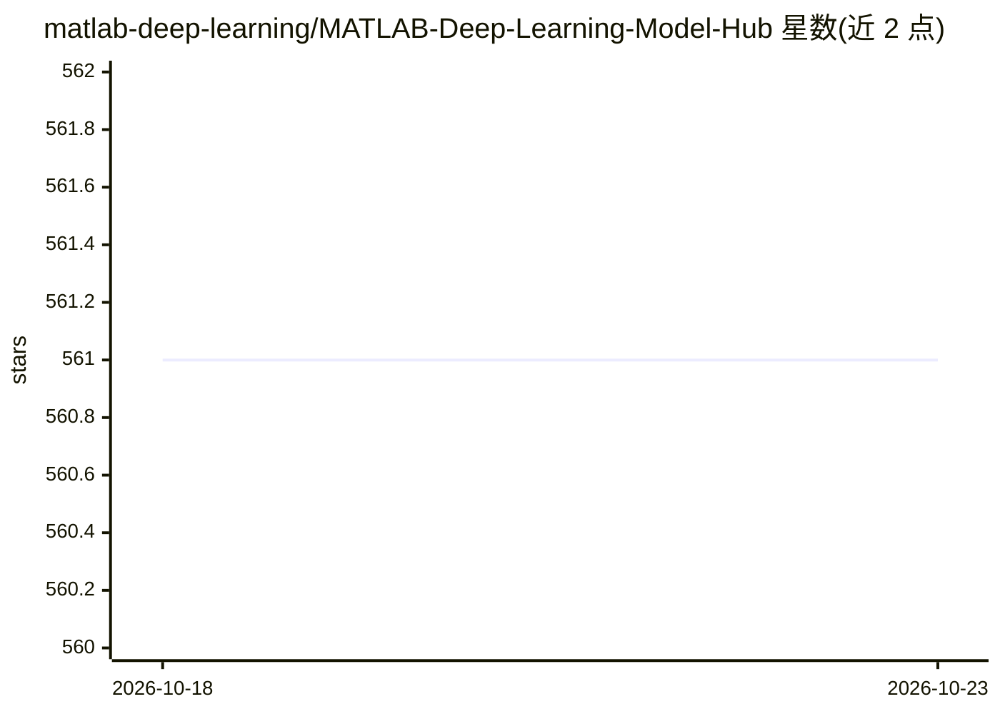

# matlab-deep-learning/MATLAB-Deep-Learning-Model-Hub

⭐ 561 · MATLAB · NOASSERTION · 推送 2026-09-29 · [GitHub](https://github.com/matlab-deep-learning/MATLAB-Deep-Learning-Model-Hub) · [官网](https://www.mathworks.com/solutions/deep-learning.html) · 组织维护

**MATLAB 预训练深度学习模型目录：按任务分类的模型清单**

MathWorks 维护的 MATLAB 预训练模型索引（Model Hub）：按计算机视觉（图像分类、目标检测、分割、姿态估计、3D 重建、视频分类、文本检测）、NLP Transformer、音频（嵌入/分类/语音转文字）、激光雷达点云、机器人运动规划等任务类别组织模型条目。每个条目列出网络名称、模型大小、精度/mAP、类别数与获取位置（官方文档或 GitHub），并说明各任务的输入输出形式。访问方式为 MATLAB 的 imagePretrainedNetwork/audioPretrainedNetwork 等函数，仓库本身不提供安装命令。

## 筛选速览

| 维度 | 判定 | 备注 |
|---|---|---|
| AI 角色 | `ai-knowledge` | 知识聚合/清单类 |
| 许可风险 | `none` | NOASSERTION |
| 部署形态 | `None` |  |
| 模型依赖 | — | README 未给出锁定关系 |
| 硬件要求 | — | 无带数字的原话,不猜 |
| 安装摩擦 | `low` | 无编译、无系统依赖或容器化 |
| 成熟度 | — | 结构信号不足 |

## 能力要点

- 覆盖 15+ 个任务类别的预训练模型清单
- 条目含模型大小、精度指标与文档/GitHub 获取位置
- 标注 R2024a 起的函数式访问方式（如 imagePretrainedNetwork）
- 含图像分类、检测、分割、音频、点云、运动规划等任务的输入输出说明

## 适用场景

- 按精度/大小权衡为我的任务挑选 MATLAB 预训练网络
- 查找目标检测或分割类模型的可用变体与文档入口
- 为迁移学习寻找起点模型并了解获取途径

## 场景标签

`精选清单` · 领域:学习与行业

## 证据(README 行号)

> L3: Discover pretrained models for deep learning in MATLAB.
> L5: ## Models <a name="Models"/>

## 星数曲线

2026-10-18 561 → 2026-10-23 561（+0）

---
*卡片 v1 · prompt 1.4 · 生成 2026-10-21 · 置信度 high · 依据 README sha `3fb6584a871a` · [字段定义](../../DATASET.md)*
