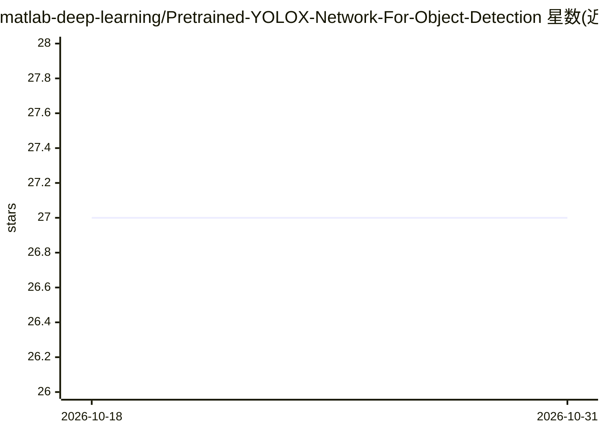

# matlab-deep-learning/Pretrained-YOLOX-Network-For-Object-Detection

⭐ 27 · NOASSERTION · 推送 2026-10-04 · [GitHub](https://github.com/matlab-deep-learning/Pretrained-YOLOX-Network-For-Object-Detection) · [官网](https://www.mathworks.com/help/vision/ug/getting-started-with-object-detection-using-deep-learning.html) · 组织维护

**MATLAB 预训练 YOLOX 目标检测网络（s/m/l，COCO 80 类）**

MathWorks 提供的 MATLAB 预训练 YOLOX 目标检测网络仓库，含 yolox_s、yolox_m、yolox_l 三种规模，基于 COCO 2017 数据集训练，可检测 80 类物体。用户加载预训练模型即可对图像执行检测，也可通过 trainYOLOXObjectDetector 函数在自有标注数据集上做迁移学习，返回 yoloxObjectDetector 对象。运行需 MATLAB R2023b 及以上，并依赖 Deep Learning Toolbox、Computer Vision Toolbox 及其 Automated Visual Inspection Library 附加功能库，旧版本 MATLAB 需使用指定分支。

## 筛选速览

| 维度 | 判定 | 备注 |
|---|---|---|
| AI 角色 | `ai-native` | 本体是模型或模型工具 |
| 许可风险 | `none` | NOASSERTION |
| 部署形态 | `None` |  |
| 模型依赖 | — | README 未给出锁定关系 |
| 硬件要求 | — | 无带数字的原话,不猜 |
| 安装摩擦 | `low` | 无编译、无系统依赖或容器化 |
| 成熟度 | — | 结构信号不足 |

## 能力要点

- 提供 yolox_s/yolox_m/yolox_l 三种预训练检测网络
- 基于 COCO 2017 训练，支持 80 类物体检测
- trainYOLOXObjectDetector 支持自有数据集迁移学习
- 可在 MATLAB Online 中打开

## 适用场景

- 在 MATLAB 中直接对图像做 80 类目标检测
- 用自有标注数据迁移学习定制 YOLOX 检测器
- 小目标检测场景参考 PCB 缺陷检测示例

## 场景标签

`目标检测` · 领域:感知与多模态

## 证据(README 行号)

> L3: This repository provides multiple pretrained YOLOX [1] object detection networks for MATLAB®, trained on the COCO 20
> L32: To train a YOLOX object detection network on a labeled data set, use the trainYOLOXObjectDetector function. You mus

## 星数曲线

2026-10-18 27 → 2026-10-31 27（+0）

---
*卡片 v1 · prompt 1.4 · 生成 2026-10-26 · 置信度 high · 依据 README sha `44be834a73ac` · [字段定义](../../DATASET.md)*
