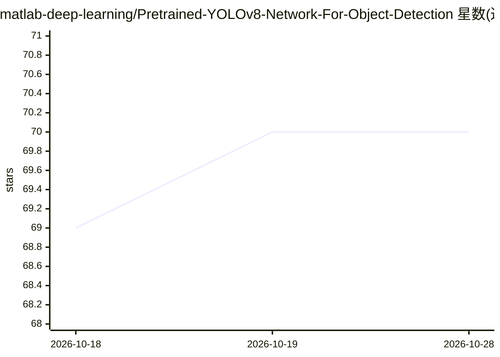

# matlab-deep-learning/Pretrained-YOLOv8-Network-For-Object-Detection

⭐ 70 · MATLAB · AGPL-3.0 · 推送 2026-01-23 · [GitHub](https://github.com/matlab-deep-learning/Pretrained-YOLOv8-Network-For-Object-Detection) · [官网](https://in.mathworks.com/help/vision/ug/getting-started-with-object-detection-using-deep-learning.html) · 组织维护

**MATLAB 版 YOLOv8 预训练模型库：目标检测与实例分割**

由 MathWorks 维护的 YOLO v8 MATLAB 实现，提供在 COCO 2017 数据集上训练的 n/s/m/l/x 五种规模预训练网络（检测与实例分割各一套），可检测 80 类物体，并支持用自定义数据集进行迁移学习训练。使用方式为 clone 仓库后在 MATLAB 中调用 yolov8ObjectDetector/yolov8 加载模型并推理；训练环节通过 installUltralytics.m 脚本自动搭建独立 Python 环境并 pip 安装 Ultralytics 包，训练需 GPU 驱动。另支持 GPU Coder/MATLAB Coder/FPGA 代码生成部署与 Simulink 仿真。需 MATLAB R2024a 及多个工具箱，许可证为 AGPL v3.0。

## 筛选速览

| 维度 | 判定 | 备注 |
|---|---|---|
| AI 角色 | `ai-native` | 本体是模型或模型工具 |
| 许可风险 | `viral` | AGPL-3.0 |
| 部署形态 | `None` |  |
| 模型依赖 | — | README 未给出锁定关系 |
| 硬件要求 | — | 无带数字的原话,不猜 |
| 安装摩擦 | `medium` | 含编译或系统依赖之一 |
| 成熟度 | — | 结构信号不足 |

## 能力要点

- 五种规模（n/s/m/l/x）COCO 预训练检测与实例分割网络
- 支持自定义数据集 YOLO 格式迁移学习训练
- GPU Coder / MATLAB Coder / Deep Learning HDL Toolbox 代码生成部署
- 提供 Simulink 模型与各模型 mAP/体积指标表

## 适用场景

- 在 MATLAB 中直接对图像做 80 类物体检测或实例分割
- 用自己的数据集微调 YOLOv8 检测器
- 将检测模型经代码生成部署到 CUDA GPU 或 FPGA 嵌入式平台

## 场景标签

`目标检测` `微调` · 领域:感知与多模态

## 证据(README 行号)

> L3: This repository offers a variety of pretrained YOLO v8[1] networks for object detection and instance segmentation in
> L26: ### Download the pretrained network
> L127: yolov8Det = trainYOLOv8ObjectDetector('data.yaml','yolov8n.pt', ImageSize=[720 720 3], MaxEpochs=10);

## 星数曲线

2026-10-18 69 → 2026-10-28 70（+1）

---
*卡片 v1 · prompt 1.4 · 生成 2026-10-24 · 置信度 high · 依据 README sha `792f314573e9` · [字段定义](../../DATASET.md)*
