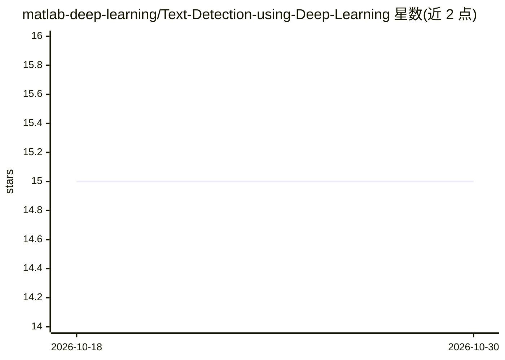

# matlab-deep-learning/Text-Detection-using-Deep-Learning

⭐ 15 · NOASSERTION · 推送 2026-03-26 · [GitHub](https://github.com/matlab-deep-learning/Text-Detection-using-Deep-Learning) · [官网](https://www.mathworks.com/products/deep-learning.html) · 组织维护

**MATLAB 预训练 CRAFT 模型：检测图像中的自然场景文本**

由 MathWorks 开发的 MATLAB 实现：在图像中运行预训练 CRAFT 深度学习模型进行文本检测，以 VGG-16 为骨干网络，输出 region score 与 affinity score，定位单个字符并分组为文本实例，可检测长文本、弯曲文本等任意形状文本。检测结果可传入 ocr 函数做文本识别。训练数据覆盖英语、韩语、意大利语、法语、阿拉伯语、德语和孟加拉语。要求 MATLAB R2022a 及以上、Deep Learning Toolbox、Computer Vision Toolbox 及其 Text Detection 支持包。

## 筛选速览

| 维度 | 判定 | 备注 |
|---|---|---|
| AI 角色 | `ai-native` | 本体是模型或模型工具 |
| 许可风险 | `none` | NOASSERTION |
| 部署形态 | `None` |  |
| 模型依赖 | — | README 未给出锁定关系 |
| 硬件要求 | — | 无带数字的原话,不猜 |
| 安装摩擦 | `low` | 无编译、无系统依赖或容器化 |
| 成熟度 | — | 结构信号不足 |

## 能力要点

- 预训练 CRAFT 模型（VGG-16 骨干）实现场景文本检测
- detectTextCRAFT 函数输出边界框，可传入 ocr 做识别
- 支持长文本、弯曲及任意形状文本检测
- 在 ICDAR2013 上 Hmean 91.81，ICDAR2017 上 69.53

## 适用场景

- 在 MATLAB 中检测名片、照片等图像里的场景文本
- 结合内置 ocr 函数完成检测加识别的完整 OCR 流程
- 需要字符级定位的自然场景文本处理项目

## 场景标签

`OCR` · 领域:感知与多模态

## 证据(README 行号)

> L3: This repository implements a pretrained Character Region Awareness For Text detection (CRAFT) [1] model in MATLAB&re
> L22: CRAFT uses a convolutional neural network to produce two outputs, region score, and affinity score. The region scor

## 星数曲线

2026-10-18 15 → 2026-10-30 15（+0）

---
*卡片 v1 · prompt 1.4 · 生成 2026-10-30 · 置信度 high · 依据 README sha `74b7f3889f7b` · [字段定义](../../DATASET.md)*
