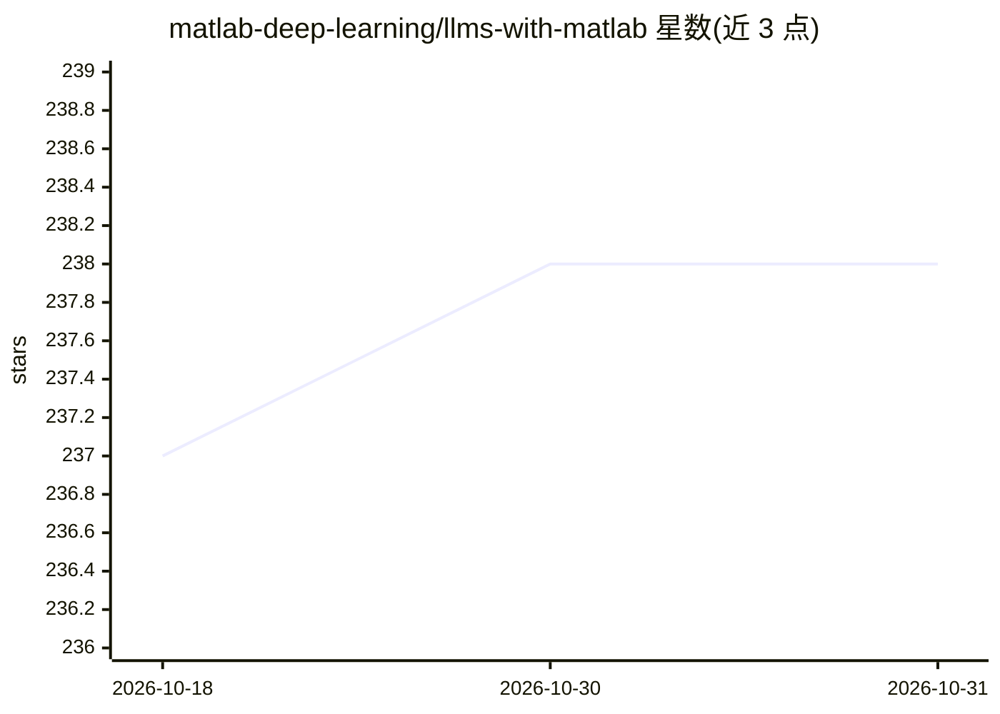

# matlab-deep-learning/llms-with-matlab

⭐ 238 · MATLAB · NOASSERTION · 推送 2026-09-11 · [GitHub](https://github.com/matlab-deep-learning/llms-with-matlab) · 组织维护

**让 MATLAB 连接各大 LLM API 的官方工具箱**

MathWorks 官方维护的 MATLAB 附加功能（add-on），在 MATLAB 中连接 OpenAI Chat Completions、OpenAI 兼容 API、OpenAI Images、Azure OpenAI Service 与本地 Ollama，支持生成回复、管理聊天历史、结构化输出、工具调用、MCP 外部工具调用与图像生成编辑。提供 openAIChat/azureChat/ollamaChat 等函数。需 MATLAB R2024a 或更新版本，可通过 Add-On Explorer、MATLAB Online 或克隆仓库安装。README 声明不再增加新功能，并指向研究预览版 MATLAB AI Agent SDK 作为替代方向。

## 筛选速览

| 维度 | 判定 | 备注 |
|---|---|---|
| AI 角色 | `ai-ecosystem` | LLM/agent 周边工具 |
| 许可风险 | `none` | NOASSERTION |
| 部署形态 | `None` |  |
| 模型依赖 | local-ok | 支持本地模型 |
| 硬件要求 | — | 无带数字的原话,不猜 |
| 安装摩擦 | `low` | 无编译、无系统依赖或容器化 |
| 成熟度 | — | 结构信号不足 |

## 能力要点

- 支持 OpenAI / Azure OpenAI / Ollama 及 OpenAI 兼容 API 接入
- 工具调用、结构化输出与 MCP 外部工具（需 MATLAB MCP HTTP Client 附加功能）
- openAIChat / azureChat / ollamaChat 等专用连接函数
- 附大量示例：Agent 工作流、RAG、流式输出、函数调用

## 适用场景

- 在 MATLAB 脚本中调用 ChatGPT 或本地 Ollama 模型处理文本与数据
- 构建带工具调用与聊天历史的对话脚本
- 在数据分析流程中嵌入 LLM 分析表格与文档

## 场景标签

`数据分析` `图像生成` · 领域:效率与自动化

## 证据(README 行号)

> L5: Large Language Models (LLMs) with MATLAB lets you connect to large language model APIs using MATLAB®.
> L14: - OpenAI® Chat Completions API — For example, connect to ChatGPT™.
> L86: |openAIChat|Connect to OpenAI Chat Completion API from MATLAB|

## 星数曲线

2026-10-18 237 → 2026-10-31 238（+1）

---
*卡片 v1 · prompt 1.4 · 生成 2026-10-22 · 置信度 high · 依据 README sha `1b7cad481dca` · [字段定义](../../DATASET.md)*
