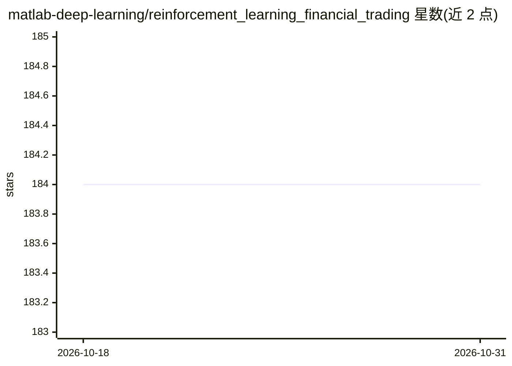

# matlab-deep-learning/reinforcement_learning_financial_trading

⭐ 184 · MATLAB · NOASSERTION · 推送 2026-02-13 · [GitHub](https://github.com/matlab-deep-learning/reinforcement_learning_financial_trading) · [官网](https://www.mathworks.com/products/reinforcement-learning.html) · 组织维护

**MATLAB 强化学习股票交易示例（单智能体+多智能体）**

MathWorks 官方 MATLAB 示例项目，演示用强化学习训练股票交易策略，分单智能体与多智能体两部分：环境含 3 只股票（几何布朗运动模拟或 AlphaVantage 历史数据）、27 个动作、19 个观测值，奖励函数惩罚亏损与不合逻辑交易。多智能体部分基于 MATLAB R2023b 的多智能体强化学习功能，用 PPO 智能体相互竞争训练。运行需 MATLAB R2019b/R2023b 及 Deep Learning、Reinforcement Learning、Financial 三个工具箱，通过打开 .prj 工程并运行 Live Script 执行。单智能体训练约 80 小时（3000 episodes）。

## 筛选速览

| 维度 | 判定 | 备注 |
|---|---|---|
| AI 角色 | `ai-native` | 本体是模型或模型工具 |
| 许可风险 | `none` | NOASSERTION |
| 部署形态 | `None` |  |
| 模型依赖 | — | README 未给出锁定关系 |
| 硬件要求 | — | 无带数字的原话,不猜 |
| 安装摩擦 | `low` | 无编译、无系统依赖或容器化 |
| 成熟度 | — | 结构信号不足 |

## 能力要点

- 单智能体环境：3 只股票、27 个动作、19 个观测值
- 多智能体部分使用 3 个 PPO 智能体，其中 2 个带竞争性奖励
- 数据来自几何布朗运动模拟或 AlphaVantage 历史数据
- 提供环境/奖励函数源码 myStepFunction.m 与 Live Script 工作流

## 适用场景

- 学习如何在 MATLAB 中用强化学习构建交易策略
- 作为金融交易强化学习实验的起点进行扩展
- 比较多智能体竞争训练与单智能体训练的效果

## 场景标签

`金融量化` `强化学习` `多智能体` · 领域:Agent 开发

## 证据(README 行号)

> L21: - MATLAB version >= R2019b
> L36: - The agent in this case study is the computer.
> L139: - Leave a starting point for financial professionals to use and enhance using their own domain expertise.

## 星数曲线

2026-10-18 184 → 2026-10-31 184（+0）

---
*卡片 v1 · prompt 1.4 · 生成 2026-10-22 · 置信度 high · 依据 README sha `8a1cc8ade766` · [字段定义](../../DATASET.md)*
