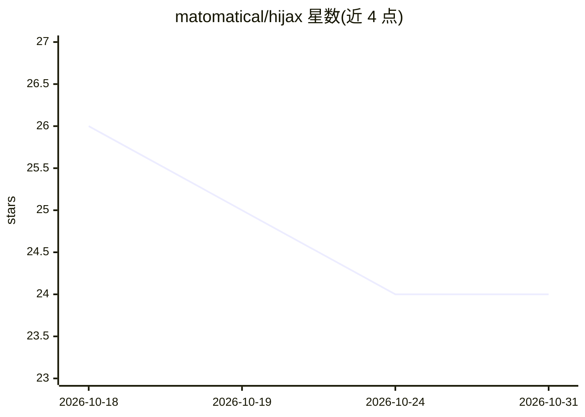

# matomatical/hijax

⭐ 24 · Python · MIT · 推送 2026-03-02 · [GitHub](https://github.com/matomatical/hijax) · [官网](https://www.youtube.com/playlist?list=PLjl5MxRQg5xrQagVEKk9J5eWWZf6AmYSr) · 个人维护

**面向深度学习研究者的 JAX 入门课程（12 讲+配套代码）**

以 12 个 YouTube 讲座视频为核心的教学课程，逐步讲解原生 JAX 的数组编程、自动微分、随机数、PyTrees、向量化、JIT 编译等内容，并配套仓库内的起始代码与解答供跟练。每讲含一个开放性挑战（如训练 MLP/CNN/Transformer、加速迷宫求解），全部完成后可进入复现论文的项目阶段。前置要求为 Python、NumPy、einops 与基础深度学习知识；跟练只需 Python 环境，无需 GPU。课程自我声明仍在制作中（视频 11/12 完成）。

## 筛选速览

| 维度 | 判定 | 备注 |
|---|---|---|
| AI 角色 | `ai-knowledge` | 知识聚合/清单类 |
| 许可风险 | `permissive` | MIT |
| 部署形态 | `library` | 以包/库形式分发 |
| 模型依赖 | — | README 未给出锁定关系 |
| 硬件要求 | — | 无带数字的原话,不猜 |
| 安装摩擦 | `medium` | 含编译或系统依赖之一 |
| 成熟度 | `idea` | |

## 能力要点

- 12 讲视频 + 仓库起始代码与解答的跟练结构
- 每讲附开放性挑战（共 12 个）
- 内容覆盖 autograd、vmap、jit、lax.scan 等 JAX 核心变换
- 声明跟练无需 GPU，仅 Python 环境即可

## 适用场景

- 从 NumPy/PyTorch 背景切入学习原生 JAX
- 跟练实现 MLP、CNN、Transformer 等网络的 JAX 训练代码
- 系统理解 JIT 编译与数组程序变换机制

## 场景标签

`教程课程` · 领域:学习与行业

## 证据(README 行号)

> L7: Welcome to "Hi, JAX!", an introduction to vanilla
> L9: for deep learning researchers.
> L162: * **12 Lectures**

## 星数曲线

2026-10-18 26 → 2026-10-31 24（-2）

---
*卡片 v1 · prompt 1.4 · 生成 2026-10-27 · 置信度 high · 依据 README sha `74e6b80001a9` · [字段定义](../../DATASET.md)*
