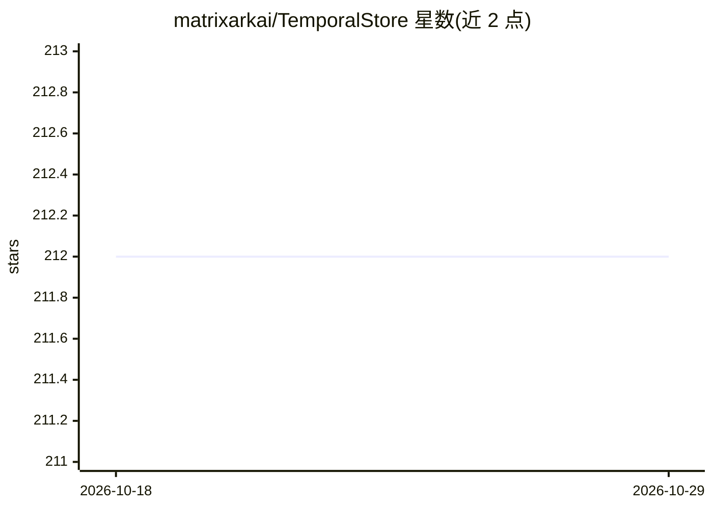

# matrixarkai/TemporalStore

⭐ 212 · Rust · Apache-2.0 · 推送 2026-10-27 · [GitHub](https://github.com/matrixarkai/TemporalStore) · [官网](https://github.com/matrixarkai/TemporalStore) · 组织维护

**Rust 时间感知存储引擎：为 LLM 上下文与特征读取路径提供单一存储**

用 Rust 编写的分布式、时间感知服务引擎，面向模型前置读取路径：排序后按 token 预算的 ContextPack 上下文管理（不用向量数据库）、按键长序列、读时聚合特征、频次封顶与控制状态配额/抑制。提供 RESP（Redis 兼容）与 HTTP 接口，现有 Redis 客户端可直接连接；单节点一条 Docker 命令运行，可经 MatrixRaft 共识扩展为复制集群。本仓库仅为 Rust 引擎，Python 上下文工具与 agent 集成位于 matrixarkai/matrixark。首个里程碑前存储格式与线上协议可能变更，需固定版本。

## 筛选速览

| 维度 | 判定 | 备注 |
|---|---|---|
| AI 角色 | `ai-ecosystem` | LLM/agent 周边工具 |
| 许可风险 | `permissive` | Apache-2.0 |
| 部署形态 | `self-host` | docker 或自建部署 |
| 模型依赖 | — | README 未给出锁定关系 |
| 硬件要求 | — | 无带数字的原话,不猜 |
| 安装摩擦 | `low` | 无编译、无系统依赖或容器化 |
| 成熟度 | `idea` | |

## 能力要点

- 单一时间索引承载六类负载，键按时间排序、追加式写、读时聚合
- RESP 兼容接口，现有 Redis 客户端可直接连接
- 上下文检索不依赖向量数据库
- 单节点一条 Docker 命令运行，MatrixRaft 共识扩展为复制集群

## 适用场景

- 为 LLM 应用提供跨会话、跨设备的上下文存储与检索
- 高频按键计数做频次封顶与配额控制
- 替代向量库+特征库+计数层多套系统的统一读取路径
- 嵌入 Rust crate 或通过 RESP/HTTP 部署为独立服务

## 场景标签

`Agent 记忆` · 领域:Agent 开发

## 证据(README 行号)

> L4: One durable store for the read paths that sit in front of a model or a request: ranked context,
> L20: |🧠 **Context management**|Ingest → extract → retrieve a ranked, token-budgeted **ContextPack**. Cross-session, cros
> L64: **This repository is the Rust engine only.** The Python context tooling — ingestion, retrieval,

## 星数曲线

2026-10-18 212 → 2026-10-29 212（+0）

---
*卡片 v1 · prompt 1.4 · 生成 2026-10-22 · 置信度 high · 依据 README sha `321fb8a2a5de` · [字段定义](../../DATASET.md)*
