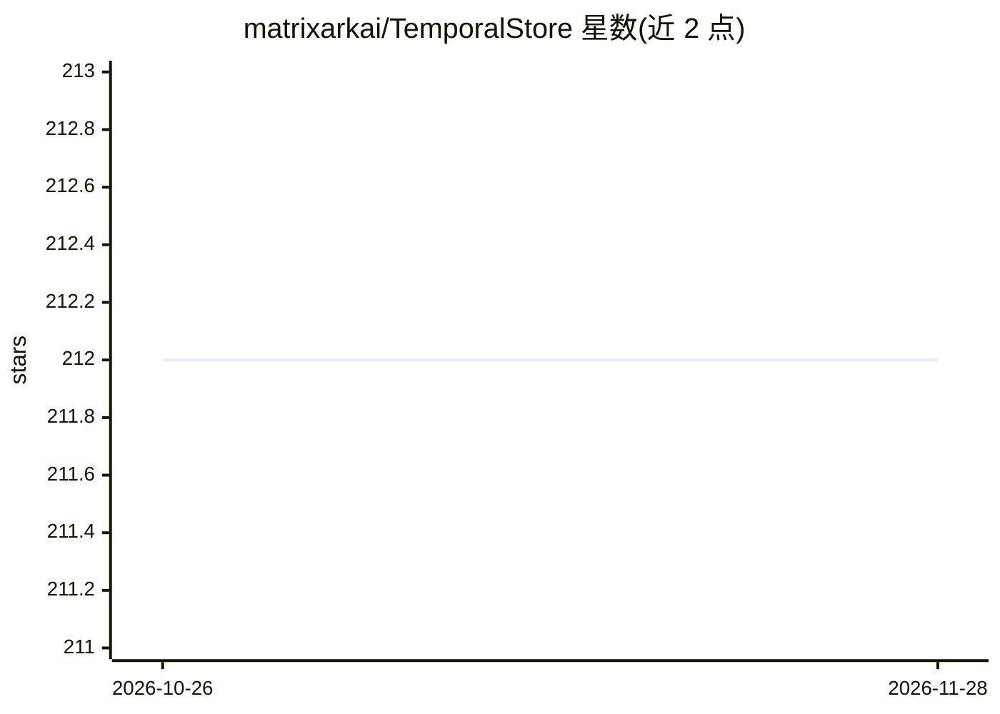

# matrixarkai/TemporalStore

⭐ 212 · Rust · Apache-2.0 · 推送 2026-11-27 · [GitHub](https://github.com/matrixarkai/TemporalStore) · [官网](https://github.com/matrixarkai/TemporalStore) · 组织维护

**Rust 存储引擎：统一服务在线特征、LLM 上下文与风控状态**

Rust 编写的存储引擎，把在线特征服务与 LLM 上下文作为同等的一等负载：提供最新值、长历史、高基数聚合、WindowReduce 特征、频次上限与 agent 记忆的存取。上下文侧涵盖上下文摄取、检索、排序、按 token 预算的打包，提供 API 与 SDK；风控侧提供原子计数器、配额、频控与风险判定状态。作为 Feast 原生 provider 提供在线物化（非离线训练存储），并与 LMCache/vLLM 集成为共享 L2 KV 缓存。限制包括：不提供向量检索、不承担离线 point-in-time 训练读取。

## 筛选速览

| 维度 | 判定 | 备注 |
|---|---|---|
| AI 角色 | `ai-ecosystem` | LLM/agent 周边工具 |
| 许可风险 | `permissive` | Apache-2.0 |
| 部署形态 | `self-host` | docker 或自建部署 |
| 模型依赖 | local-ok | 支持本地模型 |
| 硬件要求 | — | 无带数字的原话,不猜 |
| 安装摩擦 | `low` | 无编译、无系统依赖或容器化 |
| 成熟度 | — | 结构信号不足 |

## 能力要点

- Feast 原生在线 store provider：最新值物化、TTL、历史与聚合扩展
- LLM 上下文与 agent 记忆：检索与 token 预算打包
- 与 LMCache/vLLM 集成的跨 worker 共享 KV 缓存
- 控制状态负载：原子计数器、配额、频次上限与风控判定

## 适用场景

- 为推荐/搜索/广告系统提供在线特征与画像读取
- 为 LLM 应用装配带 token 预算的上下文与 agent 记忆
- 为 vLLM 多 worker 部署共享复用 KV 缓存块
- 实现频次上限、配额与风控在线状态

## 场景标签

`Agent 记忆` · 领域:Agent 开发

## 证据(README 行号)

> L3: **Open-source Rust storage for online features, LLM context, and control state.**
> L8: retrieval, ranking, token-budgeted packing, APIs, and SDKs are in TemporalStore.
> L43: |**LLM context and agent memory**|Conversations, resources, entities, reusable memory, retrieval, and token-budgete

## 星数曲线

2026-10-26 212 → 2026-11-28 212（+0）

---
*卡片 v1 · prompt 1.4 · 生成 2026-11-28 · 置信度 high · 依据 README sha `3138941f5da6` · [字段定义](../../DATASET.md)*
