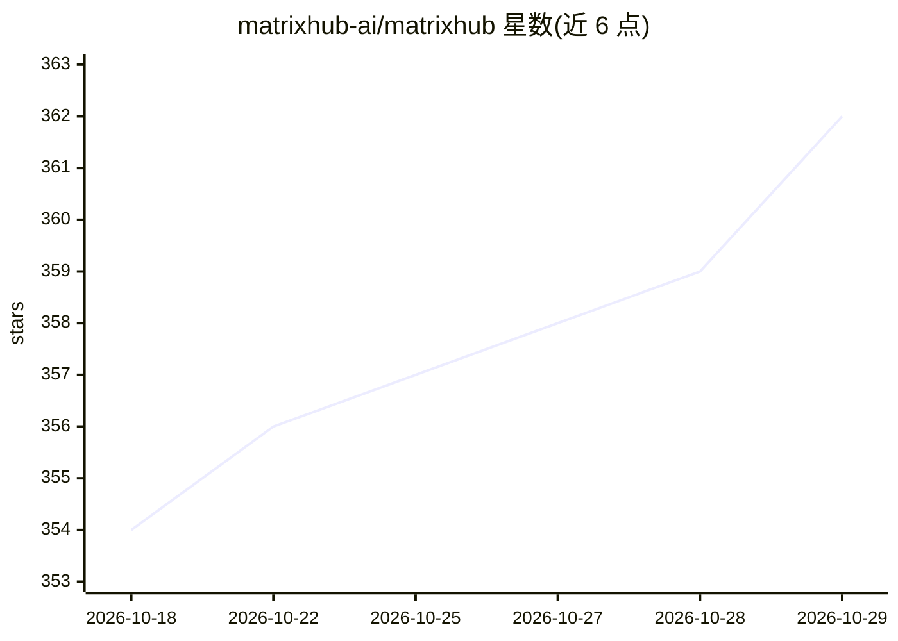

# matrixhub-ai/matrixhub

⭐ 362 · Go · Apache-2.0 · 推送 2026-10-28 · [GitHub](https://github.com/matrixhub-ai/matrixhub) · [官网](https://matrixhub.ai) · 组织维护

**自托管私有 AI 模型仓库，加速 vLLM/SGLang 推理**

开源、自托管的 AI 模型注册中心（model registry），面向大规模企业推理场景，定位为 Hugging Face 的私有化替代方案，并为 vLLM 和 SGLang 工作负载提供加速。支持 Docker Compose 与 Helm 部署，提供集成指南覆盖 vLLM、SGLang、llm-d、Dynamo 及模型分发场景。采用 Apache License 2.0，社区渠道包括 GitHub Discussions 与 CNCF Slack。README 未给出具体性能数据或部署命令细节。

## 筛选速览

| 维度 | 判定 | 备注 |
|---|---|---|
| AI 角色 | `ai-ecosystem` | LLM/agent 周边工具 |
| 许可风险 | `permissive` | Apache-2.0 |
| 部署形态 | `self-host` | docker 或自建部署 |
| 模型依赖 | local-ok | 支持本地模型 |
| 硬件要求 | — | 无带数字的原话,不猜 |
| 安装摩擦 | `low` | 无编译、无系统依赖或容器化 |
| 成熟度 | — | 结构信号不足 |

## 能力要点

- 自托管模型注册中心，作为 Hugging Face 的私有替代（drop-in）
- 为 vLLM 与 SGLang 工作负载提供加速
- 提供 Docker Compose 与 Helm 安装方式
- 提供在线演示环境（demo.matrixhub.ai）

## 适用场景

- 企业在内网自建私有模型仓库替代 Hugging Face 托管
- 配合 vLLM/SGLang 大规模推理部署管理模型
- Kubernetes 环境下通过 Helm 部署模型注册中心

## 场景标签

 · 领域:AI 基础设施/模型仓库

## 证据(README 行号)

> L6: **MatrixHub** is an open-source, self-hosted AI model registry engineered for large-scale enterprise inference. It s
> L28: For vLLM, SGLang, llm-d, Dynamo, and model distribution examples, see the Integrations guide.

## 星数曲线

2026-10-18 354 → 2026-10-29 362（+8）

---
*卡片 v1 · prompt 1.4 · 生成 2026-10-21 · 置信度 high · 依据 README sha `6ab407c64582` · [字段定义](../../DATASET.md)*
