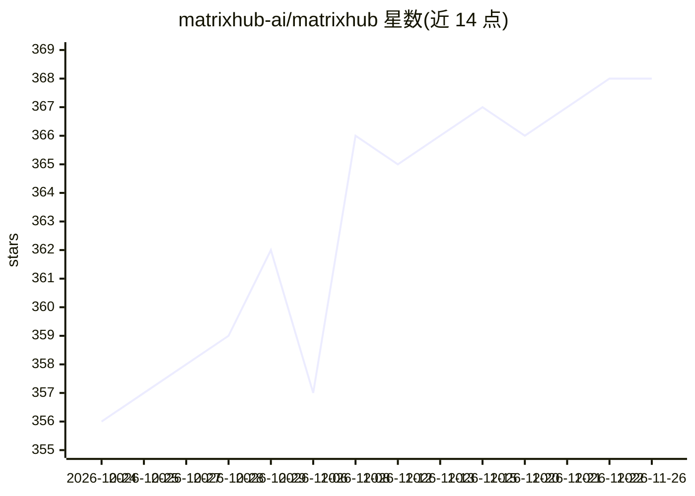

# matrixhub-ai/matrixhub

⭐ 368 · Go · Apache-2.0 · 推送 2026-11-24 · [GitHub](https://github.com/matrixhub-ai/matrixhub) · [官网](https://matrixhub.ai) · 组织维护

**自托管企业级 AI 模型仓库，兼容 Hugging Face**

MatrixHub 是一个开源、自托管的模型注册中心，面向大规模企业推理场景，定位为 Hugging Face 的私有部署替代品（自称 drop-in），并针对 vLLM 与 SGLang 工作负载做加速。提供在线演示站点（demo.matrixhub.ai，内置公共账号）；部署途径包括 Docker Compose 与 Helm；文档给出与 vLLM、SGLang、llm-d、Dynamo 及模型分发的集成示例。项目遵循 CNCF 行为准则，采用 Apache 2.0 许可。

## 筛选速览

| 维度 | 判定 | 备注 |
|---|---|---|
| AI 角色 | `ai-ecosystem` | LLM/agent 周边工具 |
| 许可风险 | `permissive` | Apache-2.0 |
| 部署形态 | `self-host` | docker 或自建部署 |
| 模型依赖 | local-ok | 支持本地模型 |
| 硬件要求 | — | 无带数字的原话,不猜 |
| 安装摩擦 | `low` | 无编译、无系统依赖或容器化 |
| 成熟度 | — | 结构信号不足 |

## 能力要点

- 自托管模型注册中心，兼容 Hugging Face
- 针对 vLLM 与 SGLang 工作负载做加速
- 提供 Docker Compose 与 Helm 部署方式
- 提供无需安装的在线演示站点

## 适用场景

- 在企业内网搭建私有模型仓库供推理服务拉取模型
- 为 vLLM/SGLang 集群集中管理与分发模型
- 在 Kubernetes 环境用 Helm 部署模型缓存服务

## 场景标签

`推理引擎` · 领域:训练与推理

## 证据(README 行号)

> L8: **MatrixHub** is an open-source, self-hosted AI model registry engineered for large-scale enterprise inference. It s
> L30: For vLLM, SGLang, llm-d, Dynamo, and model distribution examples, see the Integrations guide.

## 星数曲线

2026-10-24 356 → 2026-11-26 368（+12）

---
*卡片 v1 · prompt 1.4 · 生成 2026-11-25 · 置信度 high · 依据 README sha `5da904200b9c` · [字段定义](../../DATASET.md)*
