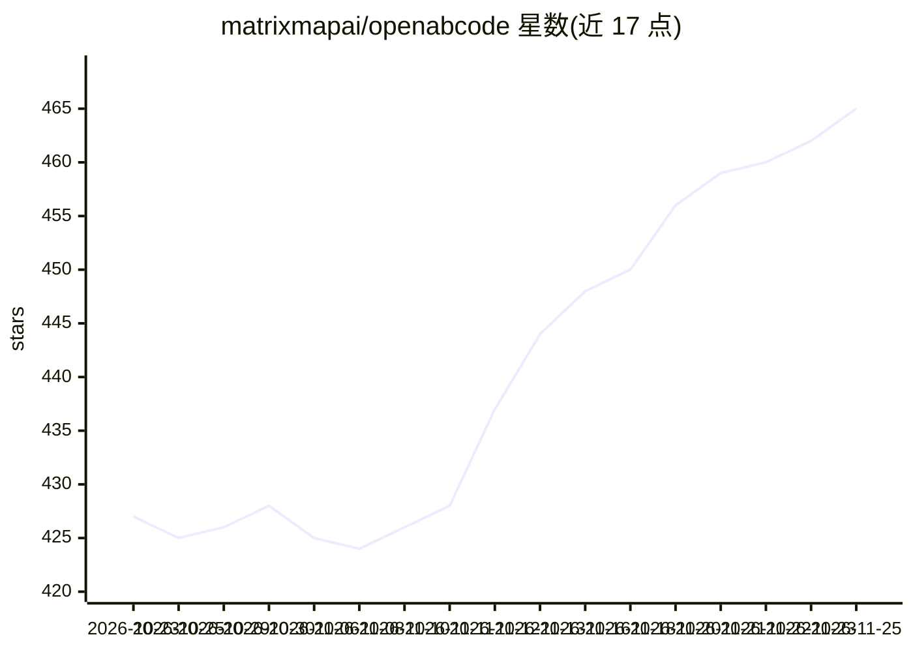

# matrixmapai/openabcode

⭐ 465 · TypeScript · AGPL-3.0 · 推送 2026-11-07 · [GitHub](https://github.com/matrixmapai/openabcode) · [官网](https://openabcode.com) · 组织维护

**按任务类型动态路由到最合适模型的编码代理 CLI**

OpenABCode 是一个 LLM 路由型终端编码代理：按任务类别把开发工作分派给不同模型家族——Google 生态任务路由到 Gemini，代码评审与测试路由到 ChatGPT，其余任务路由到 Claude。通过 /login 配置提供商、/route 打开统一路由配置面板，路由决策写入会话 JSONL 供审计，手动覆盖记录为 veto 反馈；路由规则、启发式关键词、文件扩展名映射与默认提供商均可在 settings.json 中自定义。通过托管安装脚本、npm、bun 或 brew 安装。README 说明其不含内置权限系统，建议容器化或沙箱隔离运行。

## 筛选速览

| 维度 | 判定 | 备注 |
|---|---|---|
| AI 角色 | `ai-ecosystem` | LLM/agent 周边工具 |
| 许可风险 | `viral` | AGPL-3.0 |
| 部署形态 | `library` | 以包/库形式分发 |
| 模型依赖 | — | README 未给出锁定关系 |
| 硬件要求 | — | 无带数字的原话,不猜 |
| 安装摩擦 | `low` | 无编译、无系统依赖或容器化 |
| 成熟度 | — | 结构信号不足 |

## 能力要点

- 按任务类别动态路由到 Gemini/ChatGPT/Claude 三大模型家族
- 路由决策存入会话 JSONL 可审计，手动覆盖记录为 veto 反馈
- 路由规则、启发式关键词、扩展名映射均可经 settings.json 自定义
- 提供容器化/沙箱三种隔离模式文档（Gondolin/Docker/OpenShell）

## 适用场景

- 在终端中让不同任务自动使用不同模型家族
- 需要审计每次模型路由决策的团队开发流程
- 希望自定义路由规则和默认提供商的开发者

## 场景标签

`编码 Agent` `模型网关` · 领域:Agent 开发

## 证据(README 行号)

> L7: **OpenABCode** is an LLM-routing coding agent that dynamically routes development tasks to the best-suited models:
> L81: |**@openabcode/coding-agent**|Route-first terminal coding agent CLI|

## 星数曲线

2026-10-23 427 → 2026-11-25 465（+38）

---
*卡片 v1 · prompt 1.4 · 生成 2026-11-25 · 置信度 high · 依据 README sha `9c78e5eb5018` · [字段定义](../../DATASET.md)*
