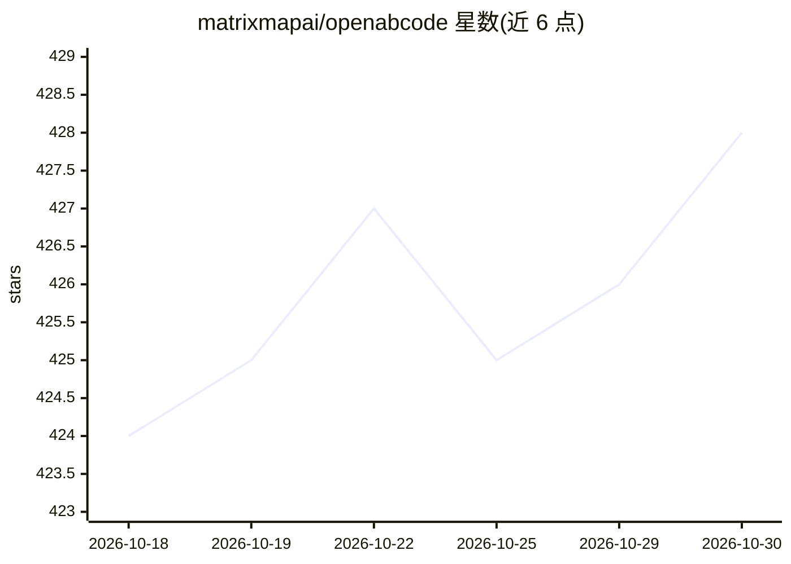

# matrixmapai/openabcode

⭐ 428 · TypeScript · AGPL-3.0 · 推送 2026-10-29 · [GitHub](https://github.com/matrixmapai/openabcode) · [官网](https://openabcode.com) · 组织维护

**按任务类型动态路由多模型的终端编码 agent**

终端编码 agent CLI，核心机制是 Route 路由：由分类模型判定任务类型，将 Google 生态任务路由到 Gemini、代码审查与测试路由到 ChatGPT、其余开发任务路由到 Claude，每个模型家族由用户指定一个具体执行模型。路由决策写入会话 JSONL 供审计，手动覆盖被记录为否决反馈；路由规则、关键词与文件扩展名映射可在全局或项目级 settings.json 中覆盖。无内置权限系统，需自行容器化隔离（Gondolin/Docker/OpenShell 三种模式）。npm/brew/curl 脚本安装，AGPL-3.0。

## 筛选速览

| 维度 | 判定 | 备注 |
|---|---|---|
| AI 角色 | `ai-native` | 本体是模型或模型工具 |
| 许可风险 | `viral` | AGPL-3.0 |
| 部署形态 | `library` | 以包/库形式分发 |
| 模型依赖 | locked-api |  |
| 硬件要求 | — | 无带数字的原话,不猜 |
| 安装摩擦 | `low` | 无编译、无系统依赖或容器化 |
| 成熟度 | — | 结构信号不足 |

## 能力要点

- Route 模式按任务类别将编码任务路由到不同模型家族
- 路由决策存入会话 JSONL，手动覆盖记录为否决反馈
- 路由规则可按项目级/全局 settings.json 自定义覆盖
- @openabcode/ai 提供多提供商统一 LLM API（OpenAI/Anthropic/Google 等）

## 适用场景

- 在终端用自然语言完成多模型协作的编码与审查任务
- 让不同模型家族各司其职：Gemini 处理 Google 生态、ChatGPT 做审查测试、Claude 做其余开发
- 按项目定制路由规则与默认提供商

## 场景标签

`编码 Agent` `代码审查` · 领域:编码与开发

## 证据(README 行号)

> L7: **OpenABCode** is an LLM-routing coding agent that dynamically routes development tasks to the best-suited models:
> L9: - Google ecosystem development tasks are routed to Gemini.
> L11: - Code review and testing are routed to ChatGPT.
> L13: - All other development tasks are routed to Claude.

## 星数曲线

2026-10-18 424 → 2026-10-30 428（+4）

---
*卡片 v1 · prompt 1.4 · 生成 2026-10-21 · 置信度 high · 依据 README sha `49b98b3d2cd5` · [字段定义](../../DATASET.md)*
