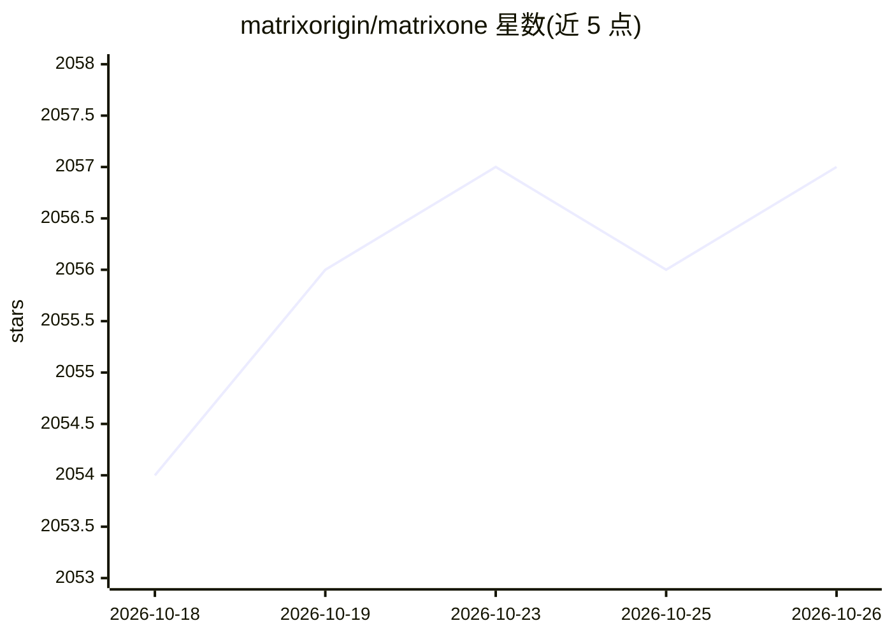

# matrixorigin/matrixone

⭐ 2,057 · Go · Apache-2.0 · 推送 2026-10-25 · [GitHub](https://github.com/matrixorigin/matrixone) · [官网](https://docs.matrixorigin.cn/mo/en/) · 组织维护 · 中文 README

**面向 AI 应用的 MySQL 兼容 HTAP 数据库，内置向量与全文搜索**

MatrixOne 是单引擎超融合的 HTAP 数据库，在同一系统内提供 OLTP、OLAP、全文检索（BM25/布尔/JSON）与向量检索（IVF/HNSW），并提供 Git 式数据版本控制：零拷贝快照、时间旅行查询、分支合并、即时回滚与完整审计轨迹。MySQL 协议兼容，可作为 MySQL 的直接替换，另提供 Python SDK（ORM 扩展）与 Pinecone 兼容向量 API。面向构建 RAG、语义检索与实时分析应用的开发者与企业；支持 Docker、源码编译、Kubernetes 与 mo_ctl 部署。

## 筛选速览

| 维度 | 判定 | 备注 |
|---|---|---|
| AI 角色 | `ai-ecosystem` | LLM/agent 周边工具 |
| 许可风险 | `permissive` | Apache-2.0 |
| 部署形态 | `self-host` | docker 或自建部署 |
| 模型依赖 | — | README 未给出锁定关系 |
| 硬件要求 | — | 无带数字的原话,不猜 |
| 安装摩擦 | `low` | 无编译、无系统依赖或容器化 |
| 成熟度 | — | 结构信号不足 |

## 能力要点

- 单引擎覆盖 OLTP/OLAP/全文/向量检索，无需 ETL 与外部向量库
- Git for Data：零拷贝快照、时间旅行、分支合并、即时回滚
- MySQL 兼容，Pinecone 兼容向量搜索 API
- Python SDK 支持 ORM 与异步向量/全文检索

## 适用场景

- 我要在一个数据库里同时跑事务、分析和向量/全文检索，替代多库同步
- RAG 应用需要向量检索加全文检索的混合搜索
- 数据变更前建分支测试迁移，出错时秒级回滚
- 复用现有 MySQL 应用与 ORM，无需改代码迁移

## 场景标签

`向量数据库` `数据分析` · 领域:效率与自动化

## 证据(README 行号)

> L56: At its core, MatrixOne is a **HTAP (Hybrid Transactional/Analytical Processing) database** with a hyper-converged *
> L78: Built-in vector search (IVF/HNSW) and full-text search. Build RAG apps and semantic search directly—no external vec

## 星数曲线

2026-10-18 2,054 → 2026-10-26 2,057（+3）

---
*卡片 v1 · prompt 1.4 · 生成 2026-10-21 · 置信度 high · 依据 README sha `eb4b386cabb9` · [字段定义](../../DATASET.md)*
