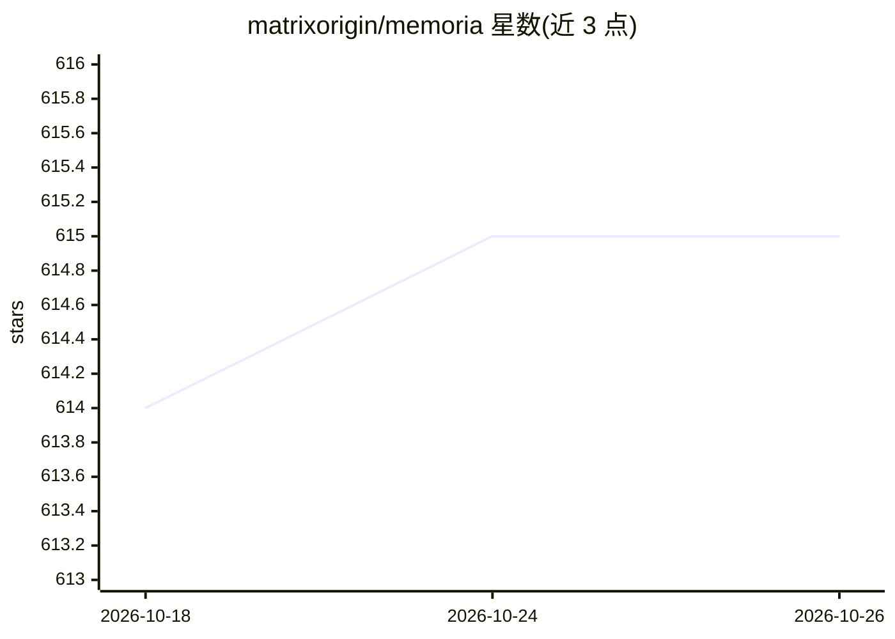

# matrixorigin/memoria

⭐ 615 · Rust · Apache-2.0 · 推送 2026-10-24 · [GitHub](https://github.com/matrixorigin/memoria) · [官网](https://thememoria.ai/) · 组织维护 · 中文 README

**AI Agent 持久记忆层：带 Git 式版本控制的记忆存储与检索**

为 AI agent 提供跨会话持久记忆层，基于 MatrixOne 的 Copy-on-Write 引擎实现快照、分支、合并与回滚等版本控制操作。提供向量+全文混合语义检索、矛盾检测与低置信记忆隔离、完整审计链，记忆分为 semantic/profile/procedural/working/episodic 五类。兼容 Kiro、Cursor、Claude Code、Codex、Gemini CLI 等 MCP 兼容 agent，有云端托管与 Docker 自托管两种模式，自托管需先配置 embedding（维度写入 schema 后锁定）。它是 MatrixOrigin Astra 的核心记忆组件。

## 筛选速览

| 维度 | 判定 | 备注 |
|---|---|---|
| AI 角色 | `ai-ecosystem` | LLM/agent 周边工具 |
| 许可风险 | `permissive` | Apache-2.0 |
| 部署形态 | `None` |  |
| 模型依赖 | — | README 未给出锁定关系 |
| 硬件要求 | — | 无带数字的原话,不猜 |
| 安装摩擦 | `low` | 无编译、无系统依赖或容器化 |
| 成熟度 | — | 结构信号不足 |

## 能力要点

- 零拷贝快照、分支、合并与时间点回滚的记忆版本控制
- 向量+全文混合语义检索
- 矛盾自动检测、低置信记忆隔离与完整审计链
- 支持任意 MCP 兼容 agent（Kiro/Cursor/Claude Code/Codex/Gemini CLI 等）

## 适用场景

- 让编码 agent 跨会话记住项目决策与偏好
- 对记忆变更做分支实验、验证后合并或回滚
- 自托管部署以完全掌控 agent 记忆数据

## 场景标签

`Agent 记忆` · 领域:Agent 开发

## 证据(README 行号)

> L24: Memoria is a **persistent memory layer** for AI agents with Git-level version control.
> L27: > **A core memory component of MatrixOrigin's Astra.**
> L67:  Works with any MCP-compatible agent

## 星数曲线

2026-10-18 614 → 2026-10-26 615（+1）

---
*卡片 v1 · prompt 1.4 · 生成 2026-10-21 · 置信度 high · 依据 README sha `cf772978b15d` · [字段定义](../../DATASET.md)*
