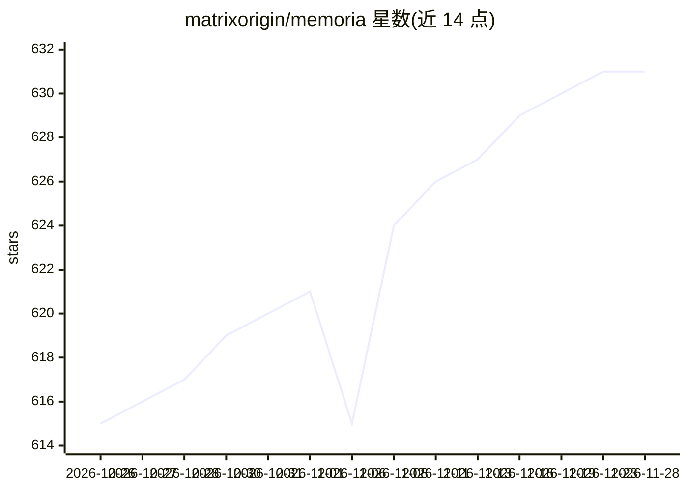

# matrixorigin/memoria

⭐ 631 · Rust · Apache-2.0 · 推送 2026-11-26 · [GitHub](https://github.com/matrixorigin/memoria) · [官网](https://thememoria.ai/) · 组织维护

**AI Agent 记忆的持久化版本管理层：快照/分支/回滚**

面向 AI Agent 的持久化记忆层，为每次记忆变更提供 Git 级版本控制：快照、零拷贝分支、合并与时间点回滚，底层由 MatrixOne 的 Copy-on-Write 引擎支撑。提供 MCP 服务器与 REST API 两类接入方式，记忆工具覆盖存取、语义检索、纠错、治理（矛盾检测与低置信隔离）等；支持本地嵌入模型使数据不出机器。可通过 Memoria Cloud（托管）、Docker 自托管或 OpenClaw 插件三种路径使用；自托管模式下嵌入维度在首次启动后锁定。

## 筛选速览

| 维度 | 判定 | 备注 |
|---|---|---|
| AI 角色 | `ai-ecosystem` | LLM/agent 周边工具 |
| 许可风险 | `permissive` | Apache-2.0 |
| 部署形态 | `None` |  |
| 模型依赖 | — | README 未给出锁定关系 |
| 硬件要求 | — | 无带数字的原话,不猜 |
| 安装摩擦 | `low` | 无编译、无系统依赖或容器化 |
| 成熟度 | `idea` | |

## 能力要点

- Git 级记忆版本控制：快照、分支、合并、回滚
- MCP 服务器与 REST API 双接入，兼容任意 MCP agent
- 自动矛盾检测与低置信记忆隔离，含完整审计链
- 本地嵌入模型选项，数据不出本机

## 适用场景

- 让 agent 跨会话记住偏好、决策与项目事实
- 在分支上隔离试验新记忆策略，验证后合并
- 对记忆变更加审计与回滚，保障数据可追溯

## 场景标签

`Agent 记忆` `语义搜索` · 领域:Agent 开发

## 证据(README 行号)

> L24: Memoria is a **persistent memory layer** for AI agents with Git-level version control.
> L67:  Works with any MCP-compatible agent
> L29: > Astra runs the agent. Memoria helps it remember across sessions. MatrixOne powers the data storage and search.

## 星数曲线

2026-10-26 615 → 2026-11-28 631（+16）

---
*卡片 v1 · prompt 1.4 · 生成 2026-11-24 · 置信度 high · 依据 README sha `ecf36ca6ba8b` · [字段定义](../../DATASET.md)*
