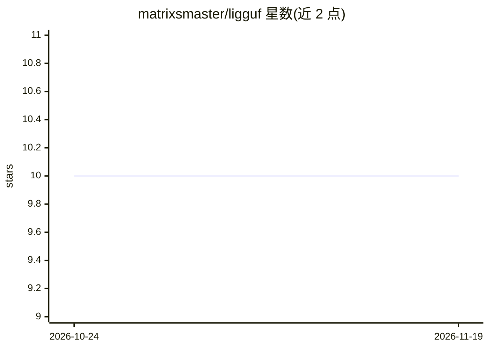

# matrixsmaster/ligguf

⭐ 10 · C++ · 推送 2026-04-04 · [GitHub](https://github.com/matrixsmaster/ligguf) · 个人维护

**给开发者的无依赖微型 GGUF 本地推理引擎**

用 C/C++ 实现的微型 LLM 推理引擎，直接通过 mmap 解析标准 GGUF 模型文件，无需转换或预处理。包含单文件参考实现（C 与 C++ 版）、模块化 FAST 引擎与一个 SARA 分布式推理示例；FAST 引擎支持 LLaMA 风格与 Qwen3 架构、多种量化格式、BERT 嵌入实现的聊天记忆检索、聊天模式与可选 SDL2 热路径可视化。核心路径零依赖，SDL2 为可选。仅提供源码，通过 make 构建，无预编译安装包。

## 筛选速览

| 维度 | 判定 | 备注 |
|---|---|---|
| AI 角色 | `ai-native` | 本体是模型或模型工具 |
| 许可风险 | `none` | — |
| 部署形态 | `None` |  |
| 模型依赖 | — | README 未给出锁定关系 |
| 硬件要求 | — | 无带数字的原话,不猜 |
| 安装摩擦 | `medium` | 含编译或系统依赖之一 |
| 成熟度 | — | 结构信号不足 |

## 能力要点

- 直接 mmap 解析 GGUF v3 文件，无转换步骤
- 支持 Q8_0/Q1_0/Q1_G/Q2_K–Q6_K 量化与 Qwen3 架构
- BERT GGUF 嵌入实现聊天日志的记忆检索
- SARA 分布式多 CPU 推理示例与可选 SDL2 可视化

## 适用场景

- 在裸机或资源受限设备上本地运行 GGUF 模型
- 逐行阅读源码学习 transformer 推理实现
- 用 BERT 嵌入为终端聊天添加检索记忆
- 多 CPU/节点分片的单流低延迟推理实验

## 场景标签

`推理引擎` · 领域:训练与推理

## 证据(README 行号)

> L3: **LiGGUF** is (probably) the first **tiny, dependency-free LLM inference engine** with **direct GGUF support**.
> L101: - **Functional:** runs full transformer inference with attention, RMSNorm, RoPE, SwiGLU, KV cache, and Top-P/Top-K
> L237: The FAST engine supports **Q8_0**, **Q1_0**, **Q1_G**, and the **Qn_K** family from **Q2_K** through **Q6_K**.

## 星数曲线

2026-10-24 10 → 2026-11-19 10（+0）

---
*卡片 v1 · prompt 1.4 · 生成 2026-11-19 · 置信度 high · 依据 README sha `b772bdebd4ae` · [字段定义](../../DATASET.md)*
