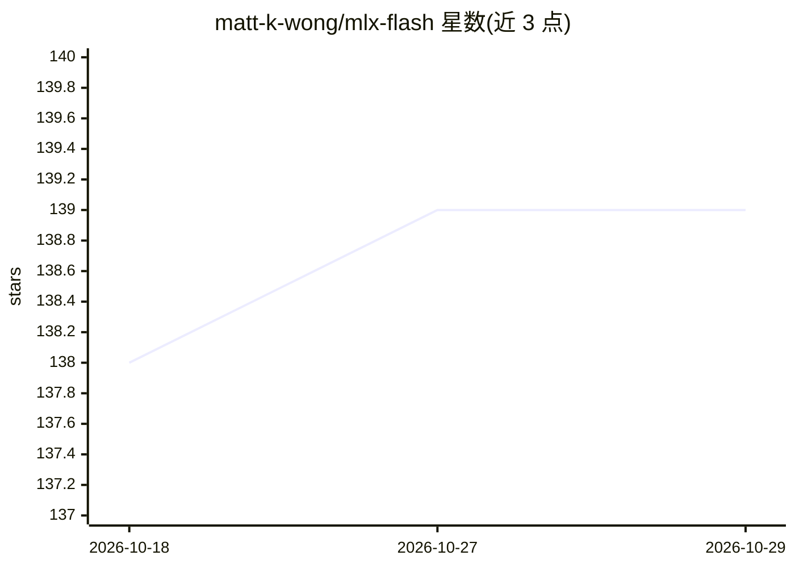

# matt-k-wong/mlx-flash

⭐ 139 · Python · MIT · 推送 2026-06-13 · [GitHub](https://github.com/matt-k-wong/mlx-flash) · [官网](https://github.com/matt-k-wong/mlx-flash) · 个人维护

**Apple Silicon 上的 MLX 权重流式引擎：跑超过内存的大模型**

面向 MLX 生态的推理加速层：通过 SSD 流式读取权重，使 16GB 内存的 Mac 可运行 30B、70B 乃至更大模型，且不额外量化、保持模型原生精度。实现上采用 Holistic Model Patching（StreamingProxy 包装原模型层），配合 MPC 式预测 I/O 调度与令牌桶限速做预取；KV 缓存采用 128 token FP16 + 其余 8-bit 磁盘量化的混合方案。以 pip（GitHub 源）安装，提供 CLI 与 Python API；要求 Python 3.11+、macOS 13+、mlx>=0.31。注意 MLX ≥ 0.31 上位级一致模式按整层执行。

## 筛选速览

| 维度 | 判定 | 备注 |
|---|---|---|
| AI 角色 | `ai-ecosystem` | LLM/agent 周边工具 |
| 许可风险 | `permissive` | MIT |
| 部署形态 | `library` | 以包/库形式分发 |
| 模型依赖 | — | README 未给出锁定关系 |
| 硬件要求 | — | 无带数字的原话,不猜 |
| 安装摩擦 | `low` | 无编译、无系统依赖或容器化 |
| 成熟度 | — | 结构信号不足 |

## 能力要点

- SSD 流式读取权重，16GB 内存可跑 30B 模型，不额外量化
- StreamingProxy 包装原模型层，复用模型自身 __call__ 逻辑
- 预测式 I/O 调度 + 令牌桶限速的预取控制回路
- 混合 KV 缓存：近 128 token FP16，旧上下文 8-bit 磁盘量化

## 适用场景

- 在小内存 Mac 上运行超出 RAM 的本地大模型
- 不牺牲模型原生精度时降低大模型内存占用
- 通过 CLI 一行命令以指定 RAM 预算运行 MLX 模型

## 场景标签

`推理引擎` · 领域:训练与推理

## 证据(README 行号)

> L3: > **Flash Weight Streaming for MLX** — run models larger than your RAM on Apple Silicon.
> L6: > **Project Lineage:** This implementation is inspired by Apple Research's paper *LLM in a Flash* (arXiv 2312.11514)

## 星数曲线

2026-10-18 138 → 2026-10-29 139（+1）

---
*卡片 v1 · prompt 1.4 · 生成 2026-10-22 · 置信度 mid · 依据 README sha `59779dd9d0a7` · [字段定义](../../DATASET.md)*
