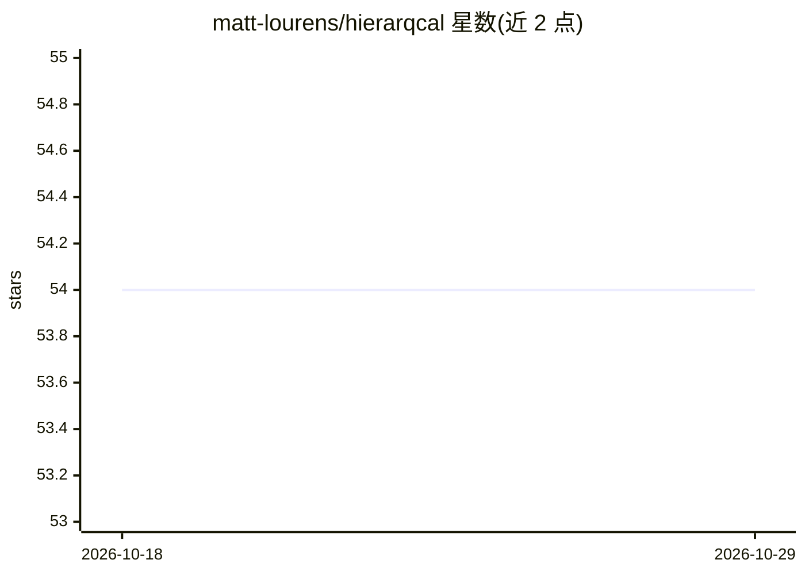

# matt-lourens/hierarqcal

⭐ 54 · Python · BSD-3-Clause · 推送 2026-09-29 · [GitHub](https://github.com/matt-lourens/hierarqcal) · [官网](https://matt-lourens.github.io/hierarqcal/) · 个人维护

**量子电路构建器：为神经架构搜索生成层次化量子电路**

HierarQcal 是一个开源、框架无关的量子电路构建 Python 包，提供层次化数据结构用于电路的设计、组合、生成、缩放与参数管理，一行代码即可构建 QCNN 或类似 MERA/张量树网络的层次电路。其面向将神经架构搜索（NAS）应用于量子计算的场景，让算法为特定任务和硬件探索电路架构。提供 Cirq、Qiskit、PennyLane 的辅助函数与教程，也可脱离任何框架独立使用；通过 pip 安装，BSD 3-Clause 许可，附 arXiv 论文。

## 筛选速览

| 维度 | 判定 | 备注 |
|---|---|---|
| AI 角色 | `ai-ecosystem` | LLM/agent 周边工具 |
| 许可风险 | `permissive` | BSD-3-Clause |
| 部署形态 | `library` | 以包/库形式分发 |
| 模型依赖 | — | README 未给出锁定关系 |
| 硬件要求 | — | 无带数字的原话,不猜 |
| 安装摩擦 | `low` | 无编译、无系统依赖或容器化 |
| 成熟度 | — | 结构信号不足 |

## 能力要点

- 层次化数据结构构建量子计算图，支持电路组合、缩放与参数管理
- 一行代码生成 QCNN 及 MERA/张量树形式的层次电路
- 框架无关：含 Cirq/Qiskit/PennyLane 辅助函数与教程，亦可独立使用
- 针对量子计算上的神经架构搜索（NAS）场景设计

## 适用场景

- 用量子神经架构搜索探索适合特定任务与硬件的电路架构
- 快速搭建 QCNN 或层次化量子电路进行实验
- 在 Qiskit/PennyLane/Cirq 等框架中复用统一的电路构建接口

## 场景标签

 · 领域:量子计算/量子机器学习

## 证据(README 行号)

> L5:  HierarQcal is a quantum circuit builder that simplifies circuit design, composition, generation, scaling, and param
> L13: #### Building a Quantum Convolutional Neural Network (QCNN) with one line of code:

## 星数曲线

2026-10-18 54 → 2026-10-29 54（+0）

---
*卡片 v1 · prompt 1.4 · 生成 2026-10-24 · 置信度 high · 依据 README sha `3eb68a726469` · [字段定义](../../DATASET.md)*
