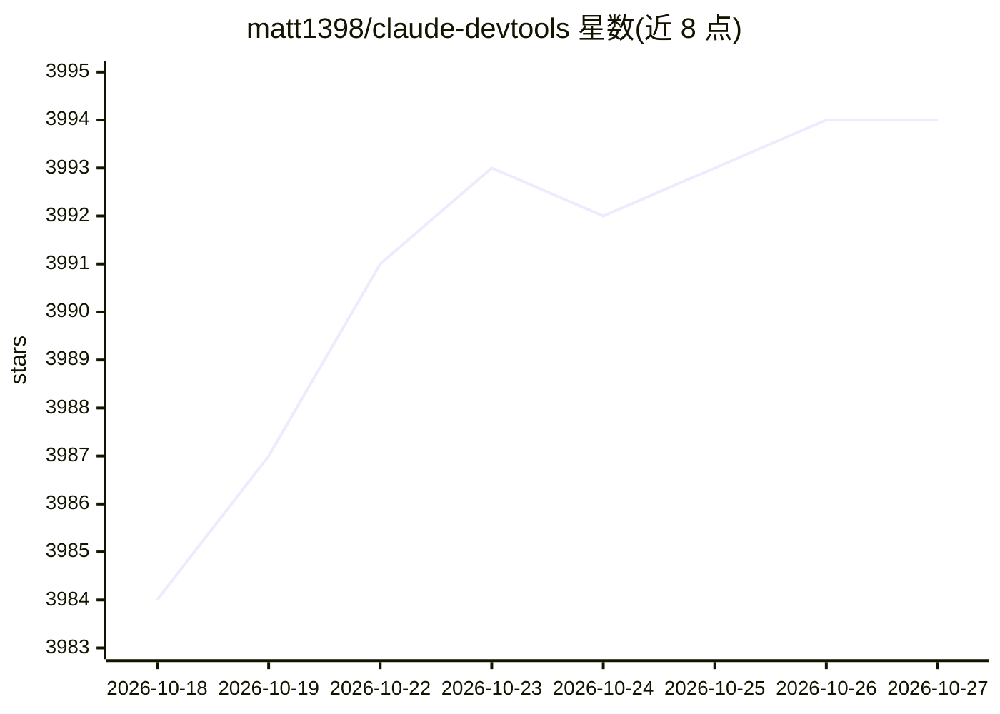

# matt1398/claude-devtools

⭐ 3,994 · TypeScript · MIT · 推送 2026-09-26 · [GitHub](https://github.com/matt1398/claude-devtools) · [官网](https://claude-dev.tools) · 个人维护

**Claude Code 会话日志的可视化调试工具，查看工具调用与 token 用量**

读取本机 ~/.claude/ 目录中已存在的 Claude Code 会话日志与转录文件，在桌面 UI 中重建完整过程：文件读取的具体路径与高亮内容、编辑的内联 diff、子代理执行树、按 7 类划分的逐轮 token 归因与压缩可视化、扩展思考内容及项目记忆浏览。支持 SSH 检查远程会话，不包装或修改 Claude Code 本身，无需 API key。提供 macOS/Linux/Windows 安装包、Homebrew 与 Docker 独立部署，Docker 版在 Node.js 上运行且无对外网络调用。

## 筛选速览

| 维度 | 判定 | 备注 |
|---|---|---|
| AI 角色 | `ai-ecosystem` | LLM/agent 周边工具 |
| 许可风险 | `permissive` | MIT |
| 部署形态 | `desktop` | 安装包/桌面程序 |
| 模型依赖 | — | README 未给出锁定关系 |
| 硬件要求 | — | 无带数字的原话,不猜 |
| 安装摩擦 | `low` | 无编译、无系统依赖或容器化 |
| 成熟度 | — | 结构信号不足 |

## 能力要点

- 逐轮 token 归因（7 类）与上下文压缩可视化
- 工具调用检查器：语法高亮、内联 diff、子代理执行树
- SSH 远程会话检查（读 ~/.ssh/config，支持密钥认证与 agent forwarding）
- 零配置读取本地日志，无需 API key，Docker 独立部署无对外网络调用

## 适用场景

- 排查 Claude Code 为什么忘掉上下文或做出意外操作
- 分析 token 消耗构成以控制成本
- 检查子代理与团队协作的完整执行过程
- 远程服务器上检查 Claude Code 会话

## 场景标签

`LLM 可观测性` · 领域:评测与运维

## 证据(README 行号)

> L7:  The debugging tool for Claude Code. Read session transcripts, inspect tool calls, track token usage — directly from
> L54: **claude-devtools is the debugging tool for Claude Code.** It reads the Claude Code logs and session transcripts al
> L143: claude-devtools does **not** wrap, modify, or interfere with Claude Code. It reads session logs that already exist

## 星数曲线

2026-10-18 3,984 → 2026-10-27 3,994（+10）

---
*卡片 v1 · prompt 1.4 · 生成 2026-10-20 · 置信度 mid · 依据 README sha `20af91024871` · [字段定义](../../DATASET.md)*
