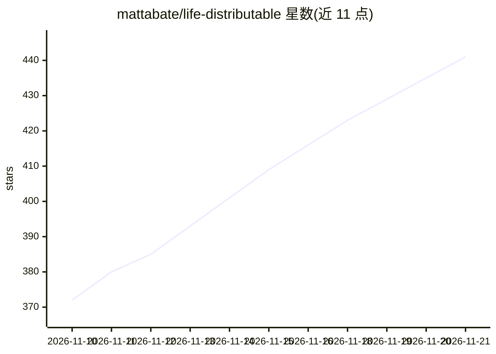

# mattabate/life-distributable

⭐ 441 · Go · MIT · 推送 2026-11-20 · [GitHub](https://github.com/mattabate/life-distributable) · [官网](https://lifedistributable.com/) · 个人维护

**自托管的个人 AI agent 团队，在 Mac 上全天候为你服务**

构建在 Claude Code 之上的自托管 AI agent 集群：每个 agent 是一个有角色分工的长运行 Claude Code 会话（如参谋长、CTO），通过任务传递协作，维护自身代码并可按需修改前后端。Mac 作为 hub，经 Tailscale 私有网络连接 iPhone、桌面与网页应用，数据留在本机。花钱、发消息、删除等危险动作需用户批准码确认。安装方式是在 Claude Code 中粘贴一句话由 agent 引导完成，需 Claude 订阅（$20-200/月）与常开的 Mac，约 2 小时，iPhone/桌面应用另需 Apple 开发者会员（$99/年）。

## 筛选速览

| 维度 | 判定 | 备注 |
|---|---|---|
| AI 角色 | `ai-native` | 本体是模型或模型工具 |
| 许可风险 | `permissive` | MIT |
| 部署形态 | `None` |  |
| 模型依赖 | locked-api |  |
| 硬件要求 | — | 无带数字的原话,不猜 |
| 安装摩擦 | `low` | 无编译、无系统依赖或容器化 |
| 成熟度 | `idea` | |

## 能力要点

- 多角色 agent 集群，agent 间通过任务传递协作
- Mac hub + Tailscale 私有网络，数据不暴露公网
- 花钱/删除/联系他人等动作需用户批准码确认
- agent 维护自身代码，可按一句话修改 UI 或加数据源

## 适用场景

- 规划每周日程并跟进个人目标
- 记账与执行投资计划
- 维护健康与日常事务，练习乐器
- 经营个人受众或推进副业项目

## 场景标签

`多智能体` `AI 助手` · 领域:Agent 开发

## 证据(README 行号)

> L7: *life* is a self-hosted team of AI agents built on [Claude Code][claude-code].
> L83: - **Roles.** Each agent is a long-running Claude Code session with a role, like chief of staff or CTO. They pass ta

## 星数曲线

2026-11-10 372 → 2026-11-21 441（+69）

---
*卡片 v1 · prompt 1.4 · 生成 2026-11-17 · 置信度 high · 依据 README sha `e286ce9ca484` · [字段定义](../../DATASET.md)*
