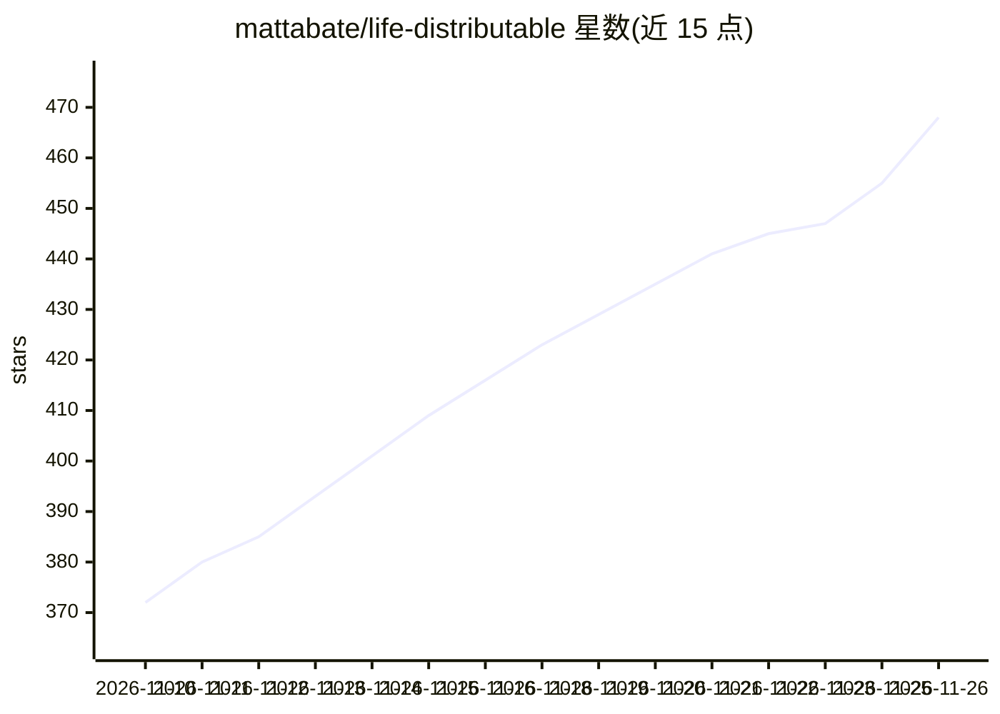

# mattabate/life-distributable

⭐ 468 · Go · MIT · 推送 2026-11-25 · [GitHub](https://github.com/mattabate/life-distributable) · [官网](https://lifedistributable.com/) · 个人维护

**自托管的个人 AI agent 团队：替你规划日程、理财与日常事务**

基于 Claude Code 构建的自托管 agent 团队，在常开的 Mac/Linux 机器上运行，通过 Tailscale 私有网络连接 iPhone、桌面与 Web 应用。每个 agent 是带角色（如 chief of staff、CTO）的长会话，互相传递任务并维护日历；界面采用卡片而非聊天流，花钱、删除、发消息等操作需用户凭 decider code 审批。安装方式为向 Claude Code 粘贴一条提示词，由 agent 按 SETUP.md 完成约 2 小时的部署；用户需 Claude 订阅，iPhone/桌面应用另需 Apple 开发者会员。

## 筛选速览

| 维度 | 判定 | 备注 |
|---|---|---|
| AI 角色 | `ai-native` | 本体是模型或模型工具 |
| 许可风险 | `permissive` | MIT |
| 部署形态 | `None` |  |
| 模型依赖 | locked-api |  |
| 硬件要求 | — | 无带数字的原话,不猜 |
| 安装摩擦 | `low` | 无编译、无系统依赖或容器化 |
| 成熟度 | `idea` | |

## 能力要点

- 多角色 agent 团队互相传递任务并维护共享日历
- 审批门控：花钱/删除/联系他人等操作需 decider code 批准
- 仅经 Tailscale 私网访问，无开放端口，备份先加密再上传
- agent 可自行修改前后端代码，应用按用户要求自我改造

## 适用场景

- 规划每周日程并跟踪待办
- 记录开销并执行投资计划
- 用手机随时审批 agent 的操作卡片
- 管理健康、跑腿与副业项目进度

## 场景标签

`多智能体` `AI 助手` · 领域:Agent 开发

## 证据(README 行号)

> L5: **A self-hosted swarm of AI agents, with apps on iPhone, Mac and web.**
> L7: *life* is a self-hosted team of AI agents built on [Claude Code][claude-code].
> L83: - **Roles.** Each agent is a long-running Claude Code session with a role, like chief of staff or CTO. They pass ta

## 星数曲线

2026-11-10 372 → 2026-11-26 468（+96）

---
*卡片 v1 · prompt 1.4 · 生成 2026-11-25 · 置信度 high · 依据 README sha `24f1a33f195d` · [字段定义](../../DATASET.md)*
