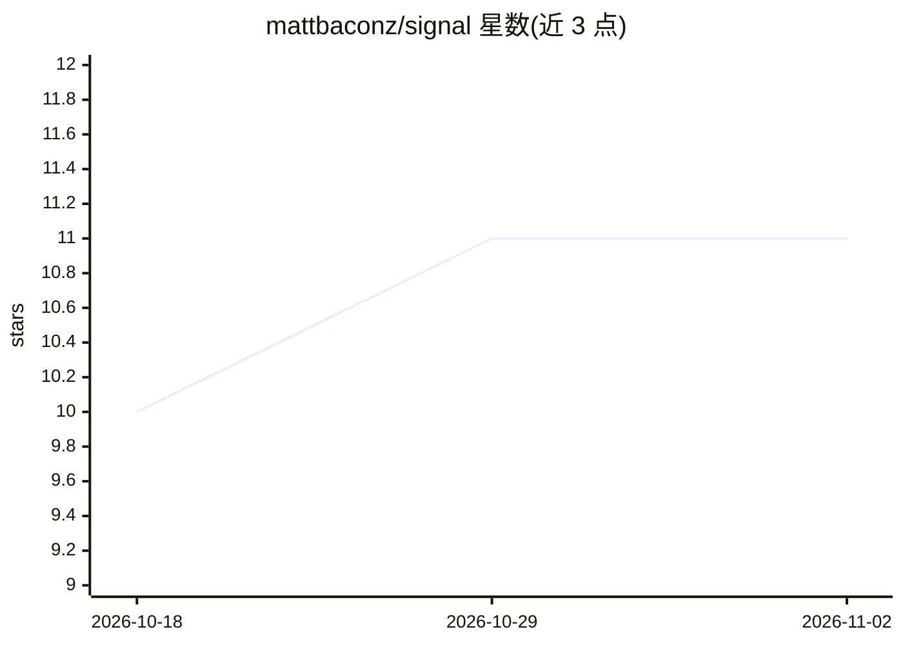

# mattbaconz/signal

⭐ 11 · PowerShell · MIT · 推送 2026-06-17 · [GitHub](https://github.com/mattbaconz/signal) · 个人维护

**编码 Agent 的 token 压缩技能包：精简指令与回复、检查点管理会话**

面向 Claude Code、Cursor、Gemini CLI、Codex 等 Agent Skills 宿主的技能集合：通过分层入口（signal1/2/3）让 agent 输出结构化简短回复，提供 signal-compress 输入压缩、CKPT 检查点替代粘贴完整会话历史，以及 commit/push/PR/review 等 git 工作流命令。主路径为 npx skills add 一键安装，无需克隆；可选 always-on 模式改写宿主指令文件使压缩默认生效。附静态基准脚本，宣称通过保真门控后计为中位约 73.5% 估算节省；与 Caveman 风格压缩作能力对比。

## 筛选速览

| 维度 | 判定 | 备注 |
|---|---|---|
| AI 角色 | `ai-ecosystem` | LLM/agent 周边工具 |
| 许可风险 | `permissive` | MIT |
| 部署形态 | `library` | 以包/库形式分发 |
| 模型依赖 | — | README 未给出锁定关系 |
| 硬件要求 | — | 无带数字的原话,不猜 |
| 安装摩擦 | `low` | 无编译、无系统依赖或容器化 |
| 成熟度 | — | 结构信号不足 |

## 能力要点

- 三层激活入口（signal/signal2/signal3）与结构化简短回复协议
- signal-compress 对 memory/rules/docs 做带保真检查的输入压缩
- CKPT 检查点机制替代粘贴完整会话历史
- git 工作流命令：signal-commit/push/pr/review

## 适用场景

- 长编码 Agent 会话中压缩重复上下文与输出 token
- 维护大型 AGENTS.md/CLAUDE.md 文件时压缩指令
- 让 Claude Code/Cursor/Gemini CLI 等宿主默认输出精简回复
- 通过检查点延续长会话而不撑爆上下文窗口

## 场景标签

`提示工程` · 领域:Agent 开发

## 证据(README 行号)

> L7: Professional token compression for agents: always-on SIGNAL-3, input compression, minified skill payloads, structure
> L141: |Host|Best path|Auto-activation|
> L19: |**What you run**|`npx skills add mattbaconz/signal` → **`signal3`** or **`/signal3`**. No clone required for norma

## 星数曲线

2026-10-18 10 → 2026-11-02 11（+1）

---
*卡片 v1 · prompt 1.4 · 生成 2026-11-02 · 置信度 high · 依据 README sha `ca4899b09f2a` · [字段定义](../../DATASET.md)*
