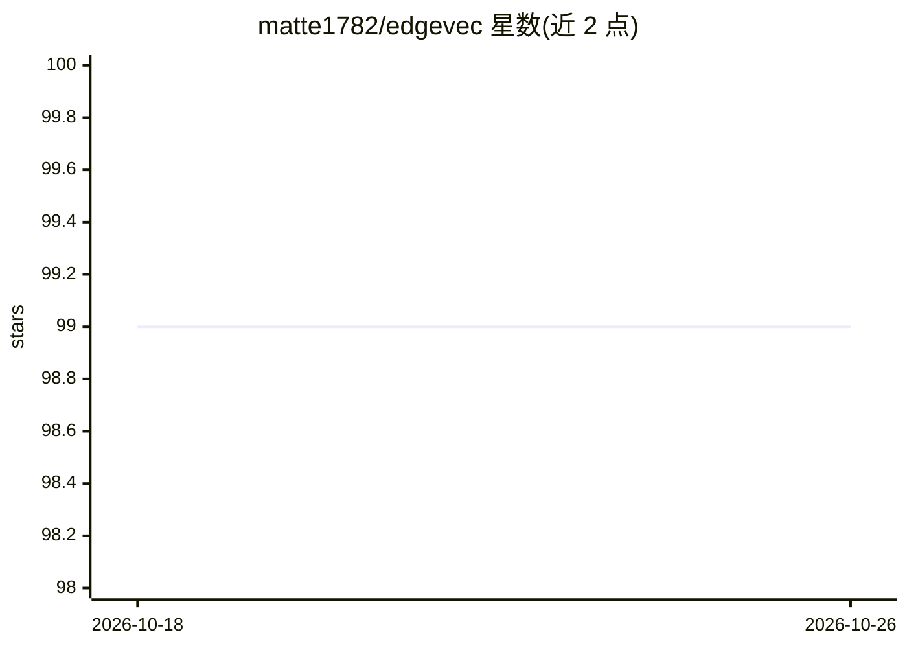

# matte1782/edgevec

⭐ 99 · Rust · Apache-2.0 · 推送 2026-10-20 · [GitHub](https://github.com/matte1782/edgevec) · 个人维护

**面向浏览器/Node/Edge 的 WASM 嵌入式向量数据库**

用 Rust 编写并以 WebAssembly 交付的嵌入式向量数据库，在浏览器内提供 HNSW 与 FlatIndex 稠密检索、CSR 稀疏向量与 BM25、RRF 混合检索、二进制量化（32x 压缩）、SQL 风格元数据过滤、软删除、IndexedDB 持久化与内存压力 API。通过 npm 与 crates.io 分发，含 Vue 3 composables 与多个浏览器演示。明确声明不适合十亿级数据、多用户并发与分布式部署（浏览器内存约 1GB 实用上限）。

## 筛选速览

| 维度 | 判定 | 备注 |
|---|---|---|
| AI 角色 | `ai-ecosystem` | LLM/agent 周边工具 |
| 许可风险 | `permissive` | Apache-2.0 |
| 部署形态 | `library` | 以包/库形式分发 |
| 模型依赖 | — | README 未给出锁定关系 |
| 硬件要求 | — | 无带数字的原话,不猜 |
| 安装摩擦 | `low` | 无编译、无系统依赖或容器化 |
| 成熟度 | — | 结构信号不足 |

## 能力要点

- HNSW + FlatIndex + 稀疏向量 + RRF 混合检索
- 二进制量化（32x 压缩）与 BinaryFlatIndex（Hamming）
- SQL 风格元数据过滤与 Memory Pressure API
- IndexedDB 持久化、SIMD 构建（Chrome/Firefox/Safari 16.4+）

## 适用场景

- 在浏览器或 Edge 环境本地做向量检索，无需服务端
- 客户端 RAG / 隐私优先的语义搜索
- 小数据集（<50K 向量）需要精确召回的场景
- 语义缓存与大规模去重（BinaryFlatIndex）

## 场景标签

`向量数据库` `语义搜索` · 领域:知识与检索

## 证据(README 行号)

> L8: > **The first WASM-native vector database.**
> L11: EdgeVec is an embedded vector database built in Rust with first-class WebAssembly support. It brings server-grade v

## 星数曲线

2026-10-18 99 → 2026-10-26 99（+0）

---
*卡片 v1 · prompt 1.4 · 生成 2026-10-23 · 置信度 high · 依据 README sha `00c26b6fcf05` · [字段定义](../../DATASET.md)*
