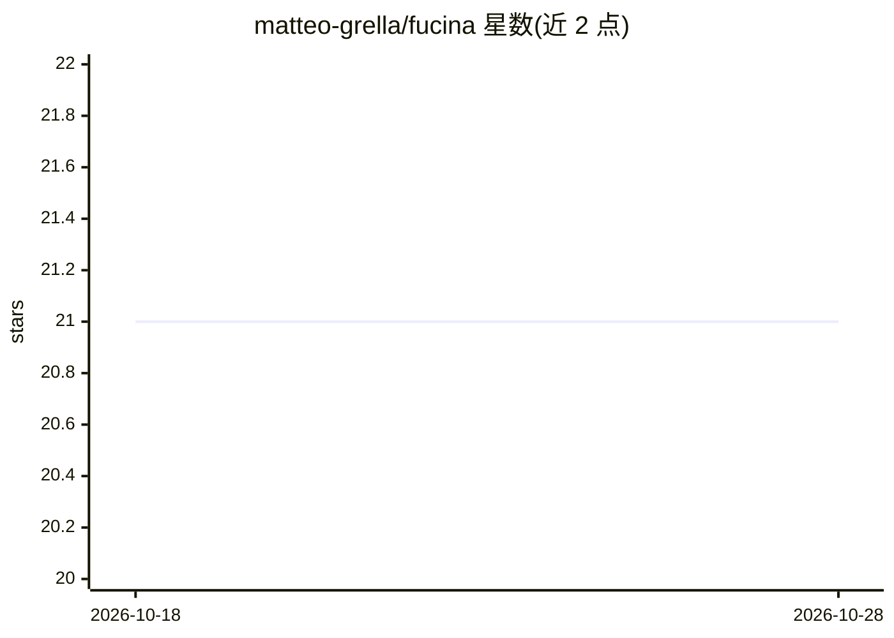

# matteo-grella/fucina

⭐ 21 · Zig · MIT · 推送 2026-09-09 · [GitHub](https://github.com/matteo-grella/fucina) · [官网](https://matteo-grella.github.io/fucina/) · 个人维护

**纯 Zig 编写的 CPU 优先张量/autograd 库与 LLM 推理训练运行时**

Fucina 是用 Zig 0.16 编写的 eager 执行张量/自动微分库：轴名在编译期检查，无 Python 运行时依赖，CBLAS 与 Metal/CUDA 为可选加速后端。仓库同时附建在其上的应用：Qwen3、DeepSeek、GLM、Gemma 等模型的 chat/serving，语音、视觉、音频模型（Parakeet 转录、TTS、人脸检测），均对照参考实现验证并与 llama.cpp 做基准对比。支持 CPU 上 LoRA 微调量化 GGUF、无损投机解码、JSON-schema 约束解码，MoE 大于内存时可从磁盘流式加载专家。API 处于 pre-1.0，构建产物针对编译机 CPU 特化。

## 筛选速览

| 维度 | 判定 | 备注 |
|---|---|---|
| AI 角色 | `ai-ecosystem` | LLM/agent 周边工具 |
| 许可风险 | `permissive` | MIT |
| 部署形态 | `None` |  |
| 模型依赖 | — | README 未给出锁定关系 |
| 硬件要求 | — | 无带数字的原话,不猜 |
| 安装摩擦 | `medium` | 含编译或系统依赖之一 |
| 成熟度 | `idea` | |

## 能力要点

- 编译期轴名检查的 eager 张量/autograd 核心，零 Python 依赖
- 运行 Qwen3/DeepSeek/GLM/Gemma 等家族的推理、serving 与 CPU LoRA 微调
- MoE 超内存模型经 --moe-stream 从磁盘分页路由专家
- 无损投机解码与 JSON-schema/正则约束解码
- 语音/视觉/音频应用（Parakeet 转录、TTS、人脸检测）对照参考实现验证

## 适用场景

- 在 Zig 项目中以库形式集成张量计算与 LLM 推理
- 在 Apple Silicon/x86 CPU 上运行和微调量化 GGUF 模型
- 复现对照 llama.cpp 的同机成对基准测试
- 按 docs/RUNNING-MODELS.md 下载已验证权重运行各模型家族

## 场景标签

`推理引擎` `微调` `模型量化` · 领域:训练与推理

## 证据(README 行号)

> L7: **Fucina** (Italian for *forge*) is a CPU-first tensor/autograd library
> L16: To prove the library on real workloads, this repository also ships complete
> L19: LLM chat and serving (Qwen3, DeepSeek, GLM,

## 星数曲线

2026-10-18 21 → 2026-10-28 21（+0）

---
*卡片 v1 · prompt 1.4 · 生成 2026-10-28 · 置信度 high · 依据 README sha `4e936c222e5b` · [字段定义](../../DATASET.md)*
