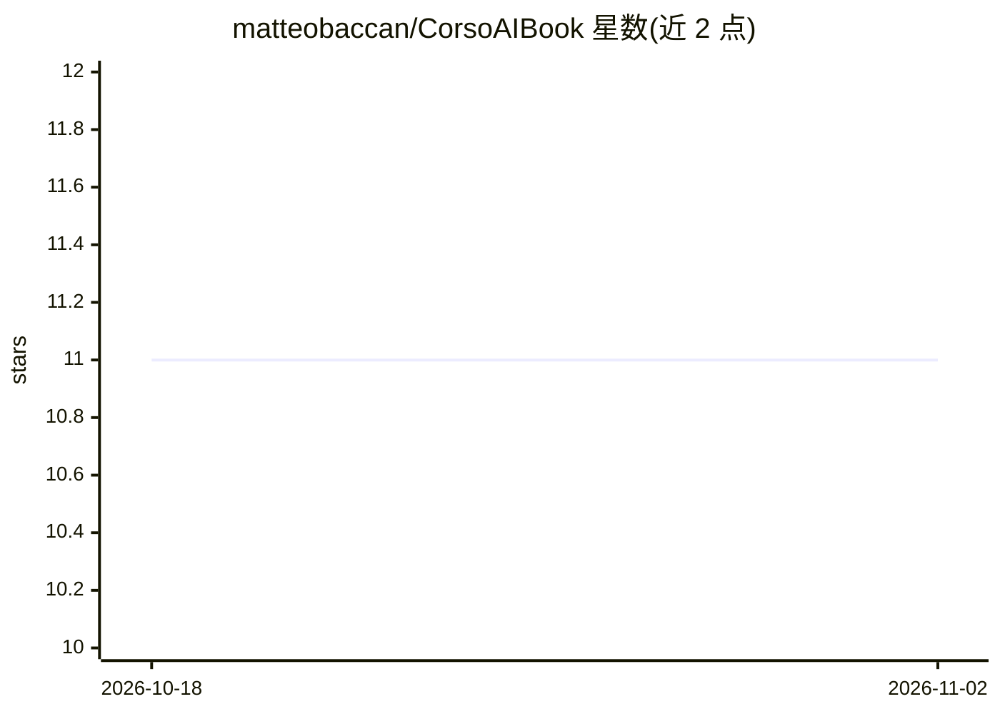

# matteobaccan/CorsoAIBook

⭐ 11 · Python · NOASSERTION · 推送 2026-10-28 · [GitHub](https://github.com/matteobaccan/CorsoAIBook) · 个人维护

**面向大众的意大利语 AI 入门书籍（12 章，多语免费下载）**

一本介绍人工智能的开放书籍项目，以 12 章覆盖 AI 定义与历史、机器学习/深度学习、生成式算法（GAN、VAE）、行业应用、评估与伦理、工具与公司等主题，源自作者的人工智能入门课程材料。目标读者从行业专业人士到初学者。全书以 CC BY-NC-SA 4.0 许可发布，提供意大利语、英语、西班牙语、法语、德语版本的免费 PDF 下载，并接受社区贡献与翻译协作。

## 筛选速览

| 维度 | 判定 | 备注 |
|---|---|---|
| AI 角色 | `ai-knowledge` | 知识聚合/清单类 |
| 许可风险 | `none` | NOASSERTION |
| 部署形态 | `None` |  |
| 模型依赖 | — | README 未给出锁定关系 |
| 硬件要求 | — | 无带数字的原话,不猜 |
| 安装摩擦 | `low` | 无编译、无系统依赖或容器化 |
| 成熟度 | — | 结构信号不足 |

## 能力要点

- 12 章覆盖 AI 理论、应用、伦理与工具
- 提供意/英/西/法/德五种语言的免费 PDF 下载
- CC BY-NC-SA 4.0 许可，开放社区贡献与翻译

## 适用场景

- 系统了解 AI 的基础概念、历史与伦理议题
- 作为 AI 入门课程的教学或自学材料
- 免费获取多语言版本的 AI 科普书籍

## 场景标签

`教程课程` · 领域:学习与行业

## 证据(README 行号)

> L8: Questo progetto è dedicato alla creazione di un libro completo e accessibile sull'**Intelligenza Artificiale (AI)**,
> L16: Il libro è organizzato in 12 capitoli che coprono un'ampia gamma di argomenti:

## 星数曲线

2026-10-18 11 → 2026-11-02 11（+0）

---
*卡片 v1 · prompt 1.4 · 生成 2026-11-02 · 置信度 high · 依据 README sha `d0a49f40211d` · [字段定义](../../DATASET.md)*
