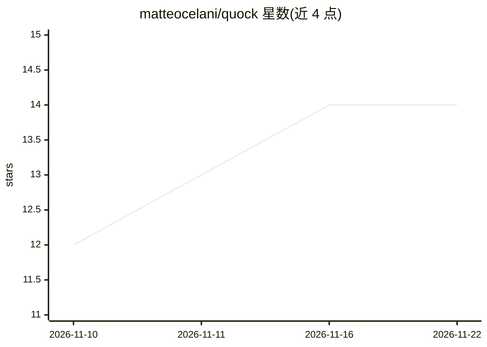

# matteocelani/quock

⭐ 14 · TypeScript · MIT · 推送 2026-11-11 · [GitHub](https://github.com/matteocelani/quock) · 个人维护

**面向 Ollama Cloud 的 iOS 聊天客户端：云端推理、本地存对话**

社区开发的 iPhone 应用（Android 版计划中），用于连接 Ollama Cloud 的云端 LLM（Gemma、Qwen、Llama、GPT-OSS、DeepSeek 等）。用户以 ollama.com 账号登录后选模型对话，回答逐词流式返回，推理在云端进行；聊天历史存储在设备本地数据库。支持按对话开启推理模式与联网搜索、长按段落追问或搜索、图片/PDF 附件（含本地 OCR）。需 ollama.com 账号；App Store 提供下载，也可用 Node 22+/pnpm/Xcode 从源码运行。

## 筛选速览

| 维度 | 判定 | 备注 |
|---|---|---|
| AI 角色 | `ai-native` | 本体是模型或模型工具 |
| 许可风险 | `permissive` | MIT |
| 部署形态 | `library` | 以包/库形式分发 |
| 模型依赖 | local-ok | 支持本地模型 |
| 硬件要求 | — | 无带数字的原话,不猜 |
| 安装摩擦 | `low` | 无编译、无系统依赖或容器化 |
| 成熟度 | — | 结构信号不足 |

## 能力要点

- 流式聊天接入 Ollama Cloud 云端模型，三步内开始对话
- 支持推理模式与对话中途联网搜索（按对话切换）
- PDF 附件问答：读取文本层或本地 OCR，页面保持在对话视图中
- 聊天历史存于设备本地数据库，仅当前发送内容上传云端

## 适用场景

- 在手机上随时使用 Ollama Cloud 的云端模型对话
- 给视觉模型发图片/截图，或对 PDF 文档提问
- 让模型联网搜索并在回答中展示推理过程

## 场景标签

`聊天机器人` `文档问答` · 领域:对话与助手

## 证据(README 行号)

> L7: A community-built iPhone client for Ollama Cloud. Chat with cloud-hosted LLMs from your phone — an `ollama.com` acco
> L15: **Quock is an iPhone client for Ollama Cloud.** Sign in once with your `ollama.com` account, pick any cloud-hosted 
> L21: - 💬 **Chat in your pocket** — sign in once, pick a model, and start typing. Responses stream back word-by-word.

## 星数曲线

2026-11-10 12 → 2026-11-22 14（+2）

---
*卡片 v1 · prompt 1.4 · 生成 2026-11-18 · 置信度 mid · 依据 README sha `68cd530ba476` · [字段定义](../../DATASET.md)*
