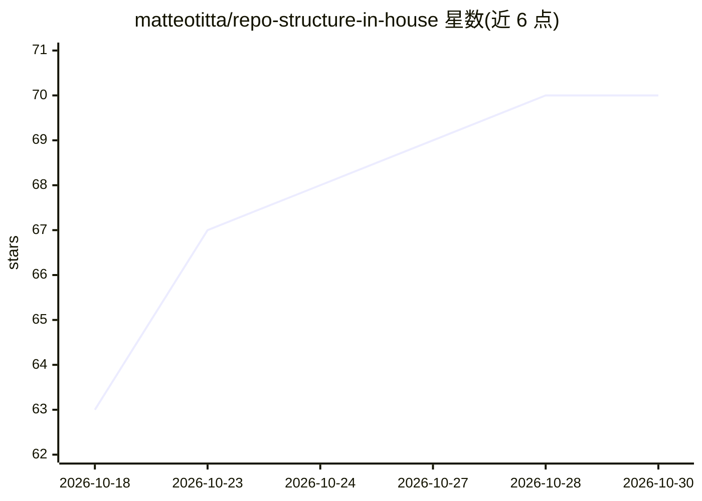

# matteotitta/repo-structure-in-house

⭐ 70 · HTML · MIT · 推送 2026-10-21 · [GitHub](https://github.com/matteotitta/repo-structure-in-house) · [官网](https://genesysgrowth.com) · 个人维护

**给 Claude Code 提供公司营销上下文的仓库模板**

面向企业内部营销人员的 GitHub 模板仓库：通过 fork/模板复制生成自己的仓库，用 5 个基础技能按顺序填充 context/ 目录（ICP、竞品、语气指南、定位、信息传递），使 Claude Code 在产出落地页、发布计划、LinkedIn 帖子等文案前先读取公司上下文。附带一个填好的虚构 B2B SaaS 示例公司；更多技能与课程以付费插件形式在 Maven 销售。本体免费、MIT 许可，由 Genesys Growth 的个人维护。

## 筛选速览

| 维度 | 判定 | 备注 |
|---|---|---|
| AI 角色 | `ai-ecosystem` | LLM/agent 周边工具 |
| 许可风险 | `permissive` | MIT |
| 部署形态 | `None` |  |
| 模型依赖 | locked-api |  |
| 硬件要求 | — | 无带数字的原话,不猜 |
| 安装摩擦 | `low` | 无编译、无系统依赖或容器化 |
| 成熟度 | — | 结构信号不足 |

## 能力要点

- context/ 目录结构配 5 个基础上下文技能（icp→competitor→tov→positioning→messaging）
- 每个文件夹带一页 CLAUDE.md 说明用途与对应技能
- 提供填好的虚构 B2B SaaS 示例公司 example/pulse-analytics/
- 网页研究可选配置 Exa API key，无 key 时回退到普通网页搜索

## 适用场景

- 营销团队让 Claude Code 写文案前先了解公司定位与语气
- 建立可维护的公司营销知识库结构（含文件所有者与 90 天清理机制）
- 按职能线路扩展付费营销技能插件（网站、AEO、LinkedIn、内容等）

## 场景标签

`AI 写作` `知识库管理` · 领域:内容生成

## 证据(README 行号)

> L5: The folder layout that gives Claude Code your company's context before it writes anything. Fork it, fill `context/` 
> L18: 3. **Fill your context in this order.** Each skill asks for what it needs and saves into the right folder:

## 星数曲线

2026-10-18 63 → 2026-10-30 70（+7）

---
*卡片 v1 · prompt 1.4 · 生成 2026-10-24 · 置信度 high · 依据 README sha `28a4a0ec46f6` · [字段定义](../../DATASET.md)*
