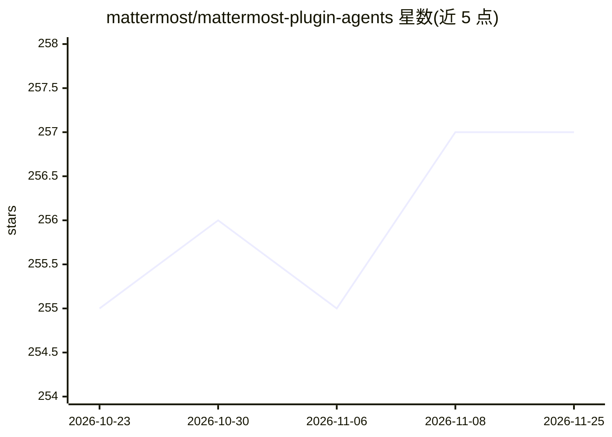

# mattermost/mattermost-plugin-agents

⭐ 257 · Go · Apache-2.0 · 推送 2026-11-23 · [GitHub](https://github.com/mattermost/mattermost-plugin-agents) · [官网](https://mattermost.com/copilot) · 组织维护

**给 Mattermost 加 AI agents 与 MCP 服务的插件**

以 Mattermost 插件形式（plugin ID mattermost-ai）为自托管 Mattermost 服务器添加 AI agents：在 Agents workspace、侧栏、私信或频道中与 agent 对话，agent 可搜索与发帖、通过 MCP 调用外部工具、生成文件与交互式 HTML 工件，并在线程/频道摘要、语义搜索、会议记录摘要中使用。支持自托管模型（Ollama、vLLM、OpenAI 兼容服务）用于隔离部署。安装方式为下载 release 包后在 System Console 上传启用；开发需 Go 与 Node.js。

## 筛选速览

| 维度 | 判定 | 备注 |
|---|---|---|
| AI 角色 | `ai-native` | 本体是模型或模型工具 |
| 许可风险 | `permissive` | Apache-2.0 |
| 部署形态 | `desktop` | 安装包/桌面程序 |
| 模型依赖 | local-ok | 支持本地模型 |
| 硬件要求 | — | 无带数字的原话,不猜 |
| 安装摩擦 | `low` | 无编译、无系统依赖或容器化 |
| 成熟度 | — | 结构信号不足 |

## 能力要点

- 内置 Mattermost MCP server，可被 Claude Code、Claude Desktop、Cursor、VS Code 等客户端接入，提供 124 个工具
- 支持 Ollama、vLLM、OpenAI 兼容服务器等自托管模型，用于 air-gapped/私有部署
- 治理与可观测：按工具审批策略、访问控制、审计日志、token 用量与 OpenTelemetry 追踪
- 多个可配置 agent（自定义指令、模型、版本与对话历史）及可复用 Skills

## 适用场景

- 在自托管 Mattermost 里让 agent 参与频道讨论并执行工具调用
- 隔离环境下用本地模型搭建私有 AI 助手
- 用 agent 做线程/频道摘要、语义搜索和会议记录摘要

## 场景标签

`AI 助手` · 领域:对话与助手

## 证据(README 行号)

> L7: Mattermost Agents (plugin ID `mattermost-ai`) adds AI agents to a Mattermost server. Talk to an agent in the Agents 
> L11: - **Sovereign AI**: Connect on-premises and self-hosted models (Ollama, vLLM, and OpenAI-compatible servers) for ai

## 星数曲线

2026-10-23 255 → 2026-11-25 257（+2）

---
*卡片 v1 · prompt 1.4 · 生成 2026-11-25 · 置信度 high · 依据 README sha `c0df09d0e40a` · [字段定义](../../DATASET.md)*
