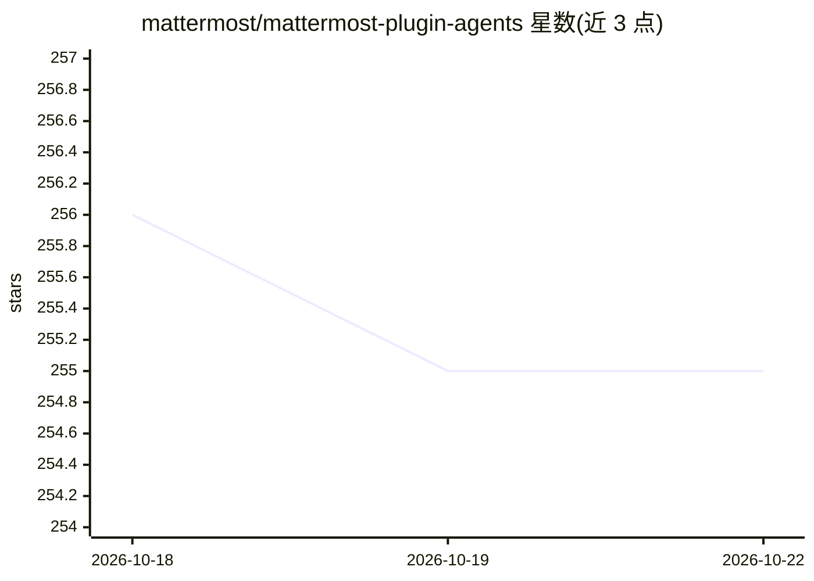

# mattermost/mattermost-plugin-agents

⭐ 255 · Go · Apache-2.0 · 推送 2026-10-21 · [GitHub](https://github.com/mattermost/mattermost-plugin-agents) · [官网](https://mattermost.com/copilot) · 组织维护

**Mattermost 的 AI 助手插件：接入本地或云端 LLM**

Mattermost 官方团队的 AI 插件，将 LLM 能力集成到 Mattermost 工作区：支持配置多个 AI 助手、线程与频道总结、行动项提取、会议转录、语义搜索、智能表情建议和直接对话。LLM 后端可选本地模型（Ollama、vLLM 等）、云厂商（OpenAI、Anthropic、Azure）或任意 OpenAI 兼容 API。要求 Mattermost Server v11.9.0+ 与带 pgvector 扩展的 PostgreSQL。通过发布页下载上传安装，或以 Go/Node.js 源码构建；另提供 Go Bridge Client 库供其他插件调用其 LLM Bridge API。

## 筛选速览

| 维度 | 判定 | 备注 |
|---|---|---|
| AI 角色 | `ai-native` | 本体是模型或模型工具 |
| 许可风险 | `permissive` | Apache-2.0 |
| 部署形态 | `desktop` | 安装包/桌面程序 |
| 模型依赖 | local-ok | 支持本地模型 |
| 硬件要求 | — | 无带数字的原话,不猜 |
| 安装摩擦 | `low` | 无编译、无系统依赖或容器化 |
| 成熟度 | `idea` | |

## 能力要点

- 多 AI 助手配置，本地模型（Ollama/vLLM）或云厂商（OpenAI/Anthropic/Azure）及任意 OpenAI 兼容 API
- 线程/频道总结、行动项提取、会议转录与语义搜索
- pgvector 支持的实例内语义搜索
- 提供 Go Bridge Client 供其他插件集成 LLM 能力

## 适用场景

- 在 Mattermost 中直接与 AI 助手对话
- 一键总结长讨论并提取行动项
- 在自有基础设施上运行本地 LLM 以掌控数据

## 场景标签

`AI 助手` `语义搜索` · 领域:对话与助手

## 证据(README 行号)

> L3: The Mattermost Agents Plugin integrates AI capabilities directly into your Mattermost workspace. **Run any local LLM
> L9: - **Multiple AI Assistants**: Configure different agents with specialized personalities and capabilities
> L16: - **Flexible LLM Support**: Use local models (Ollama, vLLM, etc.), cloud providers (OpenAI, Anthropic, Azure), or a

## 星数曲线

2026-10-18 256 → 2026-10-22 255（-1）

---
*卡片 v1 · prompt 1.4 · 生成 2026-10-22 · 置信度 high · 依据 README sha `d834d31611e9` · [字段定义](../../DATASET.md)*
