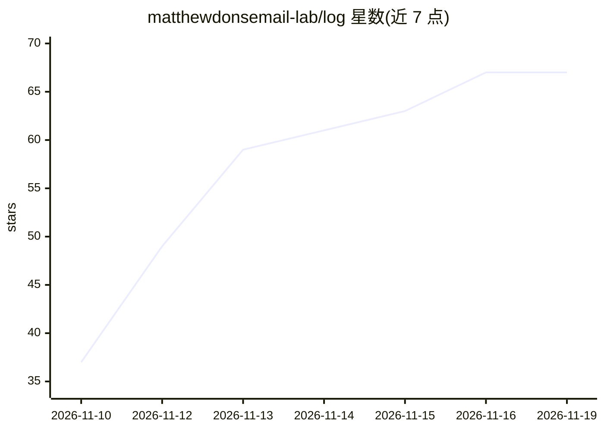

# matthewdonsemail-lab/log

⭐ 67 · TypeScript · MIT · 推送 2026-11-18 · [GitHub](https://github.com/matthewdonsemail-lab/log) · [官网](https://log.listeningkit.com) · 组织维护

**让 AI agent 从命令行/MCP 接管社媒账号的收发与回复工具**

ListeningKit 出品的开源 CLI 与 MCP 服务器（log 与 logMcp），支持用 Claude Code、Codex、Cursor、Hermes、ChatGPT 等 agent 读写 X、Discord、Slack、Instagram、Facebook、Reddit、LinkedIn 账号：读 DM、通知、群聊，发送消息、回复、点赞、关注与语音。机制上每账号维持单会话与推送 watcher，事件写入本地数据库 ~/.logCli/log.db，agent 查库而非调用平台；草稿在发送前按用户真实文风校验；所有变更命令默认 dry run，需加 --live 才执行。平台接入依赖 cookie 导入或账号浏览器登录，存在被平台限制的风险提示（restricted 状态）。

## 筛选速览

| 维度 | 判定 | 备注 |
|---|---|---|
| AI 角色 | `ai-ecosystem` | LLM/agent 周边工具 |
| 许可风险 | `permissive` | MIT |
| 部署形态 | `None` |  |
| 模型依赖 | — | README 未给出锁定关系 |
| 硬件要求 | — | 无带数字的原话,不猜 |
| 安装摩擦 | `medium` | 含编译或系统依赖之一 |
| 成熟度 | — | 结构信号不足 |

## 能力要点

- 覆盖 X/Discord/Slack/Instagram/Facebook/Reddit/LinkedIn 七个平台的读写操作
- CLI 与 MCP server 双形态，同一能力名在所有 harness 下工作
- 事件写入本地 log.db，查询毫秒级，新消息通过 hooks 推入 agent 上下文
- 默认 dry run、--live 才执行变更；草稿按用户文风校验后才发送

## 适用场景

- 让 AI agent 汇总各平台收件箱里等待回复的人
- 以自己的文风由 agent 代拟并发送社媒回复与私信
- 维护 Facebook Marketplace 商品列表与本地群组监听

## 场景标签

`工作流自动化` · 领域:效率与自动化

## 证据(README 行号)

> L13:  MCP server: logMcp
> L60: log runs your social accounts from the command line, or from your AI agent. It reads DMs, group chats, replies and 
> L97: Then ask in plain words: *"read my X DMs and tell me who's waiting on me"*. log's router names the play for that re

## 星数曲线

2026-11-10 37 → 2026-11-19 67（+30）

---
*卡片 v1 · prompt 1.4 · 生成 2026-11-18 · 置信度 high · 依据 README sha `f02de610f22f` · [字段定义](../../DATASET.md)*
