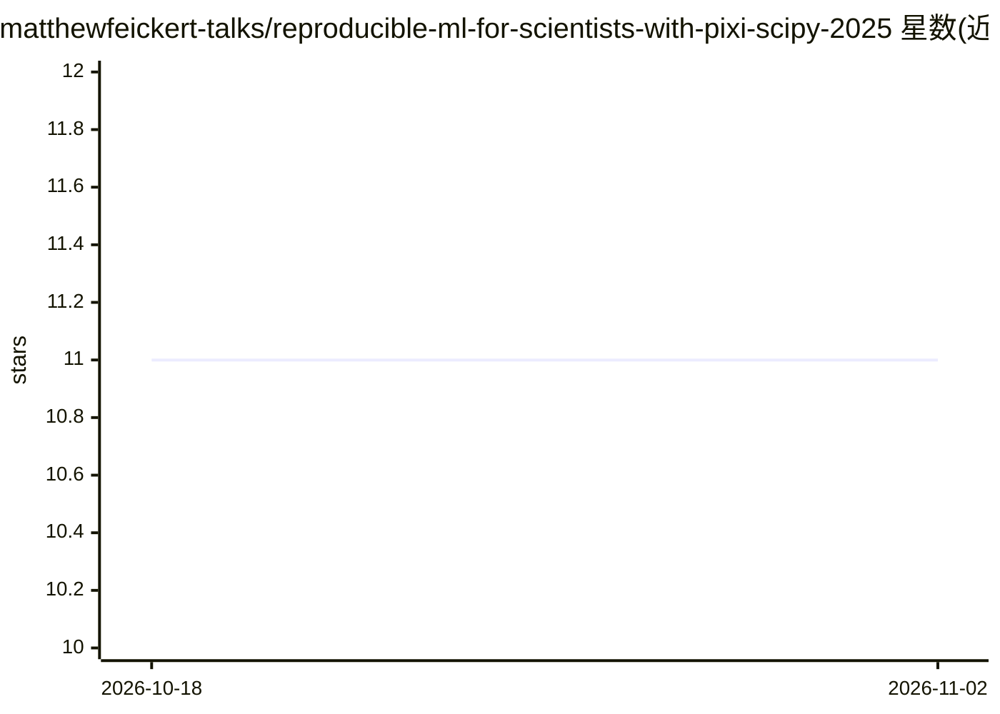

# matthewfeickert-talks/reproducible-ml-for-scientists-with-pixi-scipy-2025

⭐ 11 · Python · BSD-3-Clause · 推送 2026-03-03 · [GitHub](https://github.com/matthewfeickert-talks/reproducible-ml-for-scientists-with-pixi-scipy-2025) · [官网](https://matthewfeickert-talks.github.io/reproducible-ml-for-scientists-with-pixi-scipy-2025/) · 个人维护

**SciPy 2025 教程：用 pixi 构建可复现 ML 工作流**

面向科研人员的会议教程材料仓库，主题为使用包管理工具 pixi 构建可复现的机器学习工作流。内容以 MyST 格式组织在 book/ 目录下，通过 pixi run start 运行构建。提供 DOI（Zenodo）、YouTube 录像与 BibTeX 引用条目。属于教学/知识资源，不提供独立可安装的软件产品或模型。

## 筛选速览

| 维度 | 判定 | 备注 |
|---|---|---|
| AI 角色 | `ai-knowledge` | 知识聚合/清单类 |
| 许可风险 | `permissive` | BSD-3-Clause |
| 部署形态 | `None` |  |
| 模型依赖 | — | README 未给出锁定关系 |
| 硬件要求 | — | 无带数字的原话,不猜 |
| 安装摩擦 | `low` | 无编译、无系统依赖或容器化 |
| 成熟度 | — | 结构信号不足 |

## 能力要点

- 以 MyST 格式组织的教程讲义（book/ 目录）
- 通过 pixi run start 一键运行
- 提供 Zenodo DOI 与录像、引用条目

## 适用场景

- 学习用 pixi 管理可复现的 ML 环境
- 作为科研可复现性工作流的入门教程材料

## 场景标签

`教程课程` · 领域:学习与行业

## 证据(README 行号)

> L1: # SciPy 2025 tutorial on Reproducible Machine Learning Workflows for Scientists with Pixi
> L9: 1. Install Pixi

## 星数曲线

2026-10-18 11 → 2026-11-02 11（+0）

---
*卡片 v1 · prompt 1.4 · 生成 2026-11-02 · 置信度 mid · 依据 README sha `1a8cd7f9e7aa` · [字段定义](../../DATASET.md)*
