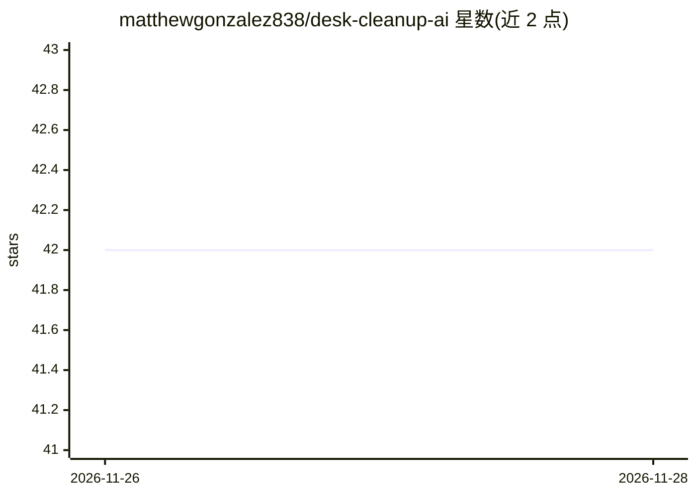

# matthewgonzalez838/desk-cleanup-ai

⭐ 42 · C++ · MIT · 推送 2026-11-25 · [GitHub](https://github.com/matthewgonzalez838/desk-cleanup-ai) · 个人维护

**本地 AI 内容识别的 Windows 文件整理去重便携工具**

面向 Windows 10/11 x64 的便携式文件整理运行套件：下载预编译包解压后指向 config/settings.json 即可运行，无编译器与外部依赖，支持配置热重载与零拷贝环形缓冲流水线。通过本地 AI 按内容理解文件、查找并分组重复文件；删除操作仅提供建议不自动执行。同时提供 git clone + CMake 的源码构建路径。

## 筛选速览

| 维度 | 判定 | 备注 |
|---|---|---|
| AI 角色 | `ai-enhanced` | 去掉 AI 部分产品仍成立 |
| 许可风险 | `permissive` | MIT |
| 部署形态 | `desktop` | 安装包/桌面程序 |
| 模型依赖 | — | README 未给出锁定关系 |
| 硬件要求 | — | 无带数字的原话,不猜 |
| 安装摩擦 | `medium` | 含编译或系统依赖之一 |
| 成熟度 | — | 结构信号不足 |

## 能力要点

- 预编译 win64 便携包，解压即用，无编译器与外部依赖
- 本地 AI 按文件内容分类整理
- 重复文件查找与分组，删除仅建议不自动执行
- JSON 配置热重载，无需重启即可生效

## 适用场景

- 整理散乱的下载/桌面文件夹
- 找出并分组磁盘上的重复文件
- 在无网络或不愿调用云端 API 的环境下本地处理文件

## 场景标签

`工作流自动化` · 领域:效率与自动化

## 证据(README 行号)

> L18: **AI File Organizer — AI File Organizer — file and tool in one tool** (`desk-cleanup-ai`) is a portable Windows 10/
> L34: Local AI by content.
> L38: No — only suggests.

## 星数曲线

2026-11-26 42 → 2026-11-28 42（+0）

---
*卡片 v1 · prompt 1.4 · 生成 2026-11-26 · 置信度 mid · 依据 README sha `c71ca014f06d` · [字段定义](../../DATASET.md)*
