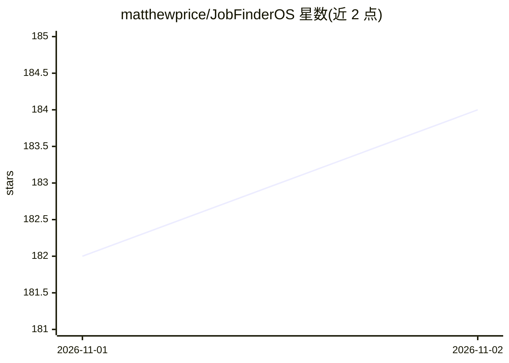

# matthewprice/JobFinderOS

⭐ 184 · Python · MIT · 推送 2026-10-31 · [GitHub](https://github.com/matthewprice/JobFinderOS) · 个人维护

**在 Claude Code 内运行的求职 agent 套件：爬岗、打分、备面试、写外联**

运行于 Claude Code 的一组 agent 角色与技能（25 个斜杠命令）：Coach 负责管道判断、面试准备、模拟面试与外联草稿；Scout 扫描公司招聘页并按用户 rubric 打分；Mark 追踪融资与人事动态。另有确定性 Python 脚本直接抓取 Greenhouse/Ashby/Lever 板块，全部结果写入可 Obsidian 打开的 Markdown vault。面向求职者，需 Claude Code 订阅、无 API key；声明从不发送邮件、从不批量投递，个人数据全部 gitignore。Python 3.11+ 仅用于可选调度器。

## 筛选速览

| 维度 | 判定 | 备注 |
|---|---|---|
| AI 角色 | `ai-native` | 本体是模型或模型工具 |
| 许可风险 | `permissive` | MIT |
| 部署形态 | `library` | 以包/库形式分发 |
| 模型依赖 | locked-api |  |
| 硬件要求 | — | 无带数字的原话,不猜 |
| 安装摩擦 | `low` | 无编译、无系统依赖或容器化 |
| 成熟度 | — | 结构信号不足 |

## 能力要点

- 三个分工 agent（Coach/Scout/Mark）加 25 个斜杠命令技能
- 确定性脚本直接抓取 ATS 招聘板块并按个人 rubric 打分
- 输出写入 Markdown vault，可用 Obsidian 阅读
- 从不发送邮件或消息，草稿进剪贴板和 vault；用户数据 gitignore

## 适用场景

- 每天跑一次任务扫描与管道梳理，读 Dashboard 决定下一步
- 面试前生成公司准备简报并进行模拟面试打分
- 把职业经历整理成故事库并生成个人风格的外联草稿

## 场景标签

`网页抓取` · 领域:效率与自动化

## 证据(README 行号)

> L7: This project capitalizes on one simple fact: a career search is a numbers game. More real contacts lead to more list
> L20: JobFinderOS is a set of agent personas and skills that run inside Claude Code and work for you to identify career o
> L32: |**Coach**|The recruiter brain. Judges the pipeline, preps you for interviews, runs mock interviews, keeps your car

## 星数曲线

2026-11-01 182 → 2026-11-02 184（+2）

---
*卡片 v1 · prompt 1.4 · 生成 2026-10-31 · 置信度 mid · 依据 README sha `3ab4236fe8d5` · [字段定义](../../DATASET.md)*
