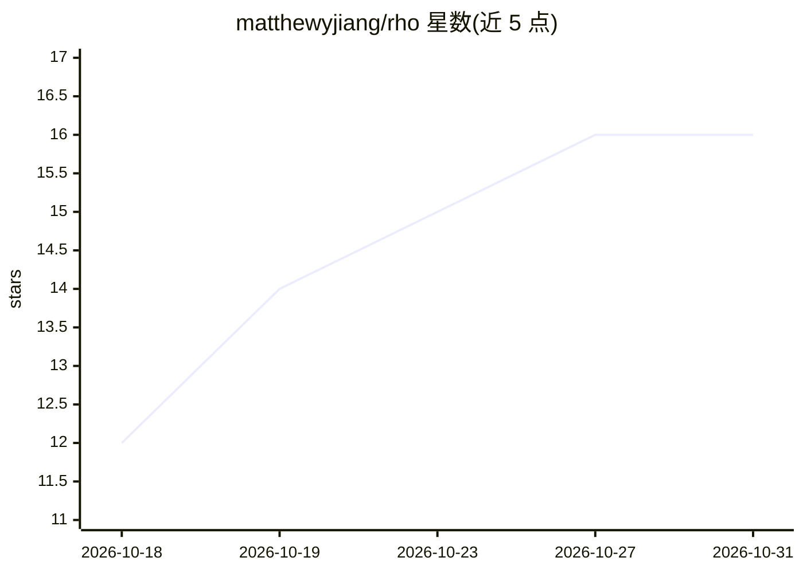

# matthewyjiang/rho

⭐ 16 · Rust · MIT · 推送 2026-10-30 · [GitHub](https://github.com/matthewyjiang/rho) · [官网](https://matthewyjiang.github.io/rho/) · 个人维护

**Rust 编写的轻量终端编码代理框架，多提供商编排**

Rho 是一个以 Rust 实现的终端优先 agent harness，面向开发者。核心机制：自带 read、edit、search、shell、web、skills、workflows 等编码工具；支持自带提供商（OpenAI、Anthropic、Gemini、Ollama、OpenRouter、Copilot 等，可用 API key 或订阅计划）；支持跨提供商的 agent 委托（含以 Claude 订阅驱动的 Claude Code agents）；提供可嵌入 SDK 构建 headless Rust agent。PATH 上存在 rtk 二进制时自动改写 shell 命令，Herdr 环境下报告 agent 状态。安装途径含 install.sh/PowerShell 脚本、Scoop 与 cargo。

## 筛选速览

| 维度 | 判定 | 备注 |
|---|---|---|
| AI 角色 | `ai-native` | 本体是模型或模型工具 |
| 许可风险 | `permissive` | MIT |
| 部署形态 | `library` | 以包/库形式分发 |
| 模型依赖 | local-ok | 支持本地模型 |
| 硬件要求 | — | 无带数字的原话,不猜 |
| 安装摩擦 | `low` | 无编译、无系统依赖或容器化 |
| 成熟度 | — | 结构信号不足 |

## 能力要点

- 跨提供商 agent 委托与编排（OpenAI/Anthropic/Gemini/Ollama/OpenRouter 等）
- 内置 read/edit/search/shell/web/skills/workflows 编码工具
- 可嵌入 SDK：显式指定 provider、工具、会话与取消
- rtk 在 PATH 时自动改写 shell 命令，无需初始化配置

## 适用场景

- 在终端里用自然语言驱动编码任务（读写文件、跑 shell、搜索）
- 跨多家模型提供商委托与编排多个 agent
- 用 SDK 构建无界面的 Rust agent 程序

## 场景标签

`编码 Agent` `Agent 框架` · 领域:Agent 开发

## 证据(README 行号)

> L5: Rho is a fast Rust agent harness with a small footprint and opinionated defaults.
> L22: - **Coding tools included**: read, edit, search, shell, web, skills, and workflows ship with Rho. Install, sign in,

## 星数曲线

2026-10-18 12 → 2026-10-31 16（+4）

---
*卡片 v1 · prompt 1.4 · 生成 2026-10-30 · 置信度 high · 依据 README sha `79de8415ab79` · [字段定义](../../DATASET.md)*
