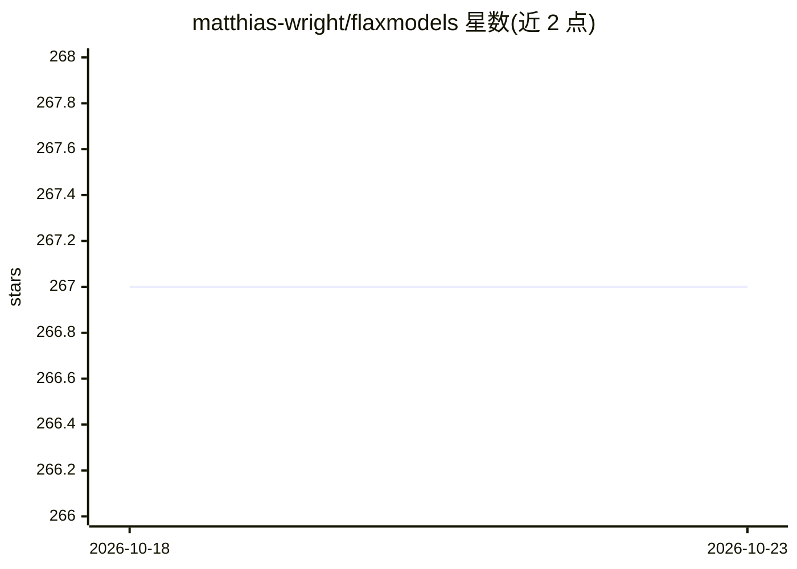

# matthias-wright/flaxmodels

⭐ 267 · Python · 推送 2026-09-04 · [GitHub](https://github.com/matthias-wright/flaxmodels) · [官网](https://github.com/matthias-wright/flaxmodels) · 个人维护

**Jax/Flax 预训练模型集合：GPT2/StyleGAN2/VGG/ResNet 等**

为 Jax/Flax 生态提供预训练深度学习模型的 Python 库，收录 GPT2、StyleGAN2、ResNet{18-152}、VGG{16,19}、FewShotGanAdaption，多数模型附带训练代码。检查点取自各模型页面引用的仓库，处理步骤与格式有文档说明。安装需 Python 3.7+，GPU 使用需先按 Jax 文档安装 CUDA，CPU-only 可跳过；通过 pip 从 GitHub 安装。每个模型有独立许可证。

## 筛选速览

| 维度 | 判定 | 备注 |
|---|---|---|
| AI 角色 | `ai-native` | 本体是模型或模型工具 |
| 许可风险 | `none` | — |
| 部署形态 | `library` | 以包/库形式分发 |
| 模型依赖 | — | README 未给出锁定关系 |
| 硬件要求 | — | 无带数字的原话,不猜 |
| 安装摩擦 | `medium` | 含编译或系统依赖之一 |
| 成熟度 | — | 结构信号不足 |

## 能力要点

- 收录 GPT2、StyleGAN2、ResNet、VGG 等预训练模型
- 多数模型附带训练代码
- 检查点来源与处理步骤有文档记录
- 支持 GPU（CUDA）与 CPU-only 两种使用方式

## 适用场景

- 在 Jax/Flax 项目中直接加载 GPT2 或 ResNet 等预训练模型
- 基于提供的训练代码微调或复现模型
- 查阅各模型检查点的来源与格式说明

## 场景标签

 · 领域:深度学习/预训练模型

## 证据(README 行号)

> L3:  A collection of pretrained models in Flax.
> L6: The goal of this project is to make current deep learning models more easily available for the awesome Jax/Flax ecos

## 星数曲线

2026-10-18 267 → 2026-10-23 267（+0）

---
*卡片 v1 · prompt 1.4 · 生成 2026-10-22 · 置信度 high · 依据 README sha `ba6e19a51672` · [字段定义](../../DATASET.md)*
