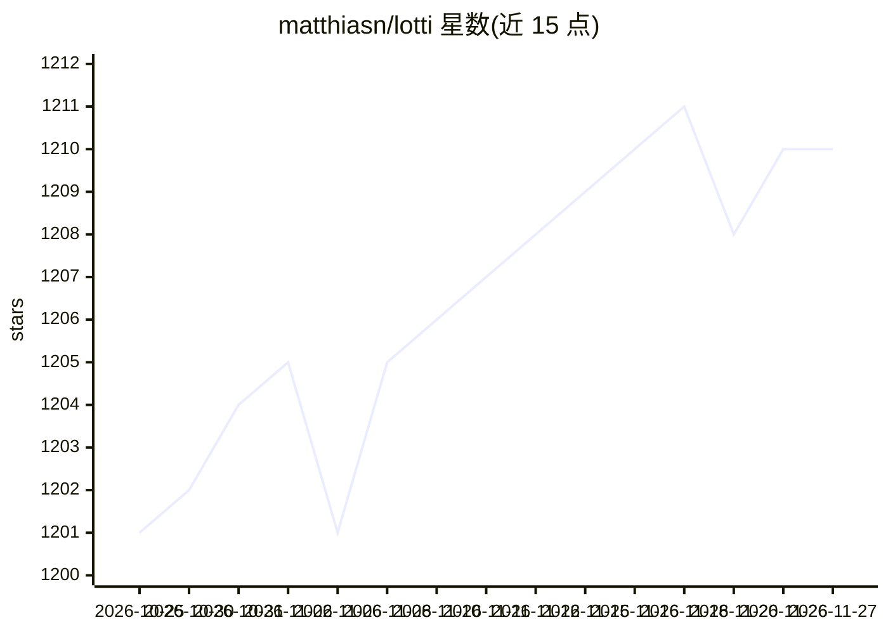

# matthiasn/lotti

⭐ 1,210 · Dart · GPL-3.0 · 推送 2026-11-26 · [GitHub](https://github.com/matthiasn/lotti) · [官网](https://matthiasn.github.io/lotti/) · 个人维护

**端到端加密的个人日志/任务应用，带需确认的 AI 助手**

Lotti 是个人任务管理、时间追踪与日志应用：数据存于各设备本地 SQLite，通过自选 Matrix homeserver 做端到端加密同步，中继只见密文。AI 机制为多类 agent（任务/项目/目标/事件/关系）读取记录并提议修改，用户逐条确认后生效；语音可转写。产品本身无推理后端，用户自带各家 API key 或接本地模型，也可完全关闭 AI 使用。支持 iOS/macOS/Android/Linux 安装包，Windows 需源码构建。GPL-3.0 许可，非 Linux 平台部分高级 agent 功能未来可能收费。

## 筛选速览

| 维度 | 判定 | 备注 |
|---|---|---|
| AI 角色 | `ai-enhanced` | 去掉 AI 部分产品仍成立 |
| 许可风险 | `viral` | GPL-3.0 |
| 部署形态 | `None` |  |
| 模型依赖 | local-ok | 支持本地模型 |
| 硬件要求 | — | 无带数字的原话,不猜 |
| 安装摩擦 | `low` | 无编译、无系统依赖或容器化 |
| 成熟度 | `idea` | |

## 能力要点

- agent 提议、用户确认的写入模式（少量白名单例外如转写）
- 经 Matrix/Vodozemac 的端到端加密同步，emoji 比对验证设备
- 按类别路由不同 AI provider，支持 OpenAI 兼容端点与本地模型
- sherpa-onnx 端上语音识别；同步协议与 agent 运行时以 TLA+ 建模并每晚模型检查

## 适用场景

- 在自有设备间加密同步地管理任务、时间与日志
- 语音口述后由 agent 整理成带清单的任务
- 按生活类别分别路由到不同 AI 服务或本地模型
- 不接受云厂商读取个人记录的隐私敏感用户

## 场景标签

`AI 助手` `语音识别` · 领域:对话与助手

## 证据(README 行号)

> L43: - **Your AI, your choice — or none.** Lotti has no inference backend. You bring
> L46:  provider. Lotti is a complete task manager, time tracker and journal with AI
> L46:  provider. Lotti is a complete task manager, time tracker and journal with AI

## 星数曲线

2026-10-25 1,201 → 2026-11-27 1,210（+9）

---
*卡片 v1 · prompt 1.4 · 生成 2026-11-23 · 置信度 high · 依据 README sha `f6e20f9690a9` · [字段定义](../../DATASET.md)*
