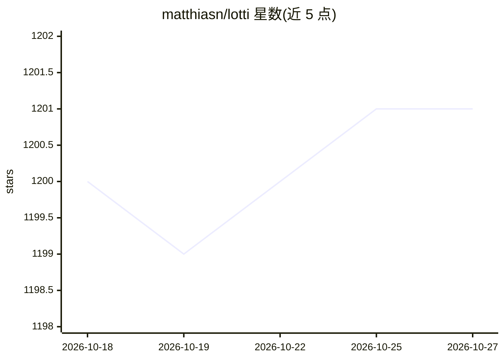

# matthiasn/lotti

⭐ 1,201 · Dart · GPL-3.0 · 推送 2026-10-26 · [GitHub](https://github.com/matthiasn/lotti) · [官网](https://matthiasn.github.io/lotti/) · 个人维护

**端到端加密的个人记录应用，AI 助手提议、用户批准**

本地优先的个人记录系统：语音笔记、截图、照片、日记等记忆存储在设备本地 SQLite，通过 Matrix 中继以 Megolm/Olm 端到端加密在自有设备间同步，服务器只见密文。其上叠加任务、人际关系、目标、事件、项目与日记应用，各配个人 AI agent：读取记录、生成摘要与下一步建议，所有改动需用户批准，少类预批准写入留有审计记录。推理依赖用户配置的模型提供商（可路由到本地模型），语音转写用 Whisper/Voxtral 本地运行。Flutter/Dart 编写，GPL-3.0，覆盖 macOS/Linux/Windows/iOS/Android。

## 筛选速览

| 维度 | 判定 | 备注 |
|---|---|---|
| AI 角色 | `ai-enhanced` | 去掉 AI 部分产品仍成立 |
| 许可风险 | `viral` | GPL-3.0 |
| 部署形态 | `desktop` | 安装包/桌面程序 |
| 模型依赖 | local-ok | 支持本地模型 |
| 硬件要求 | — | 无带数字的原话,不猜 |
| 安装摩擦 | `low` | 无编译、无系统依赖或容器化 |
| 成熟度 | `idea` | |

## 能力要点

- 本地 SQLite 存储 + Matrix 中继端到端加密同步，服务器零信任只见密文
- 任务/关系/目标/事件/项目各配 AI agent，提议-批准模式，带审批回执与审计日志
- Whisper/Voxtral 本地离线语音转写，日记可路由至本地模型或不用模型
- 向量时钟解决设备间同步冲突，记录与应用分层、代理写入独立数据库

## 适用场景

- 在自己的设备上记录并加密同步语音、照片与日记，不经云端
- 让 AI agent 整理语音笔记为任务清单、跟踪 GitHub PR 并提议更新
- 用关系 agent 在会面前获取过往谈话要点简报
- 用目标 agent 每日核查实际记录是否偏离目标并提醒

## 场景标签

`AI 助手` `知识库管理` `语音识别` · 领域:对话与助手

## 证据(README 行号)

> L17: most of them looked after by a personal AI agent that reads what you recorded and
> L137: ### 4. Inference that keeps nothing — and eventually runs on your own devices

## 星数曲线

2026-10-18 1,200 → 2026-10-27 1,201（+1）

---
*卡片 v1 · prompt 1.4 · 生成 2026-10-21 · 置信度 high · 依据 README sha `1b218412193e` · [字段定义](../../DATASET.md)*
