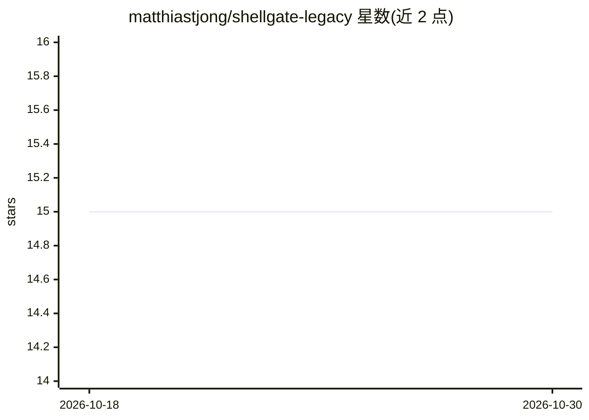

# matthiastjong/shellgate-legacy

⭐ 15 · TypeScript · MIT · 推送 2026-06-10 · [GitHub](https://github.com/matthiastjong/shellgate-legacy) · [官网](https://shellgate.ai) · 个人维护

**自托管 AI agent 凭据网关：代理请求、拦截危险命令、全量审计**

部署在 AI agent 与基础设施之间的自托管网关：agent 持有作用域受限的 sg_ token，真实 API key/SSH 凭据由网关在请求时注入，agent 不可见。支持按 token 授予目标 API 权限、即时吊销、SSH 远程命令执行、危险命令（rm -r、DROP TABLE 等）人工审批拦截，全部请求记录审计日志。功能以 MCP server 暴露，含 vault、组织技能、记忆与 wiki。以 Docker 镜像分发，需 PostgreSQL 14+；另提供托管版 Shellgate Cloud。

## 筛选速览

| 维度 | 判定 | 备注 |
|---|---|---|
| AI 角色 | `ai-ecosystem` | LLM/agent 周边工具 |
| 许可风险 | `permissive` | MIT |
| 部署形态 | `self-host` | docker 或自建部署 |
| 模型依赖 | — | README 未给出锁定关系 |
| 硬件要求 | — | 无带数字的原话,不猜 |
| 安装摩擦 | `low` | 无编译、无系统依赖或容器化 |
| 成熟度 | — | 结构信号不足 |

## 能力要点

- 真实凭据网关注入，agent 仅持有可吊销的 sg_ token
- 危险命令内置规则拦截，需人工审批后方可执行
- 以 MCP server 暴露 20+ 内置工具（api_request/ssh_exec/vault_search 等）
- 含凭据保险库、webhook 路由、组织技能、持久记忆与 wiki

## 适用场景

- 让 AI agent 访问 OpenAI/Anthropic/内部 API 而不暴露真实密钥
- 对 agent 的 SSH 命令做危险操作审批与审计
- 统一管理和吊销多个 agent 的 API 访问权限

## 场景标签

`网络安全` · 领域:学习与行业

## 证据(README 行号)

> L11: Shellgate sits between your AI agents and your infrastructure. Agents get a scoped token — they never see real cred
> L193: Shellgate exposes all agent-facing functionality as an MCP (Model Context Protocol) server. Claude Code and other 

## 星数曲线

2026-10-18 15 → 2026-10-30 15（+0）

---
*卡片 v1 · prompt 1.4 · 生成 2026-10-30 · 置信度 high · 依据 README sha `5b0ac591329c` · [字段定义](../../DATASET.md)*
