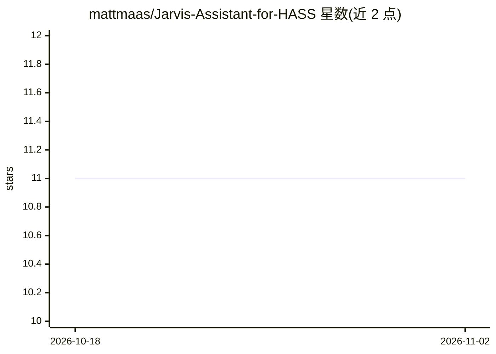

# mattmaas/Jarvis-Assistant-for-HASS

⭐ 11 · Python · MIT · 推送 2026-09-19 · [GitHub](https://github.com/mattmaas/Jarvis-Assistant-for-HASS) · 个人维护

**接入 Home Assistant 的 AI 语音助手，支持智能家居控制**

基于 Python 的语音助手项目，通过唤醒词“Jarvis”进行对话，提供任务分解、持久记忆、信息检索、代码执行与多智能体协作等能力，并集成 Home Assistant 以语音控制智能家居设备、通过 OpenRGB 控制 RGB 灯光、自动化电脑任务。运行前需分别部署 Agent Zero 框架（作者提供的 fastAPI-for-agent-zero-docker）与 Extended OpenAI Conversation 项目，Home Assistant 集成依赖其可用性；README 未给出本产品自身的安装命令。

## 筛选速览

| 维度 | 判定 | 备注 |
|---|---|---|
| AI 角色 | `ai-native` | 本体是模型或模型工具 |
| 许可风险 | `permissive` | MIT |
| 部署形态 | `None` |  |
| 模型依赖 | — | README 未给出锁定关系 |
| 硬件要求 | — | 无带数字的原话,不猜 |
| 安装摩擦 | `low` | 无编译、无系统依赖或容器化 |
| 成熟度 | — | 结构信号不足 |

## 能力要点

- 唤醒词“Jarvis”触发语音对话与多模态交互
- 集成 Home Assistant 控制智能家居设备与自动化例程
- 基于 Agent Zero 框架的工具创建与多智能体协作
- 持久记忆：记忆、召回与遗忘信息

## 适用场景

- 用语音控制我的 Home Assistant 智能家居设备
- 让助手代为执行多步骤任务与电脑自动化操作
- 通过语音进行对话、听写与信息检索

## 场景标签

`语音 Agent` · 领域:对话与助手

## 证据(README 行号)

> L9: - **Dynamic Task Handling**: Jarvis breaks down complex tasks into manageable subtasks, efficiently handling multi-s
> L31: - **Home Assistant Integration**: Control your smart home devices and automate routines through voice commands.

## 星数曲线

2026-10-18 11 → 2026-11-02 11（+0）

---
*卡片 v1 · prompt 1.4 · 生成 2026-11-02 · 置信度 mid · 依据 README sha `1a768ccafa68` · [字段定义](../../DATASET.md)*
