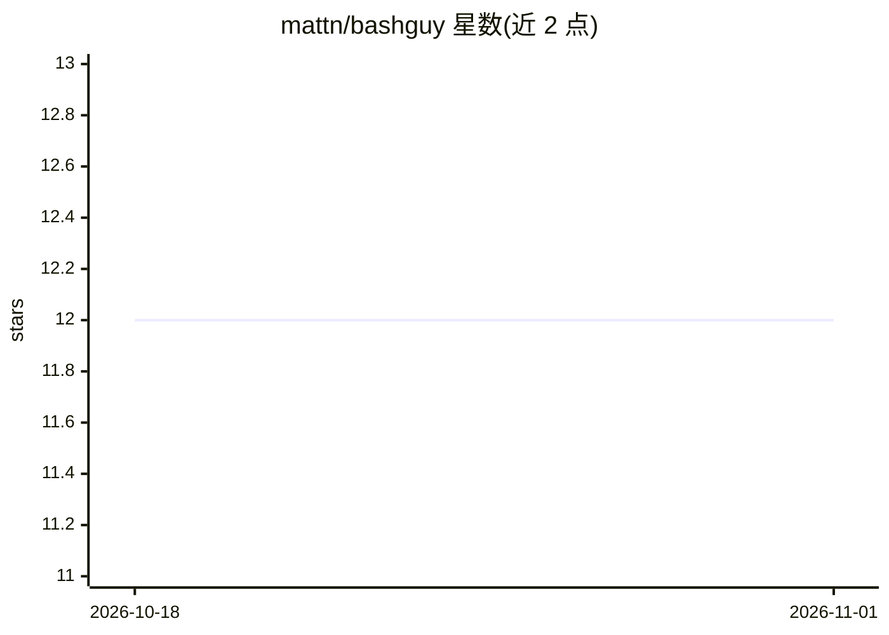

# mattn/bashguy

⭐ 12 · Shell · 推送 2026-04-08 · [GitHub](https://github.com/mattn/bashguy) · 个人维护

**Bash 小部件：用自然语言经 Claude 生成 shell 命令并插入命令行**

一个 Bash shell 脚本小部件：按下绑定键后弹出 [bashguy] 提示，用户用自然语言描述想执行的操作，由 Claude 生成对应 bash 命令并插入当前命令行；若命令行已有部分输入，则在光标位置插入补全。依赖 Claude Code CLI（claude 命令）与 Bash，通过 source 脚本加载，默认不绑定按键，需自行 bind。可通过 BASHGUY_MODEL 环境变量更换模型，默认 claude-sonnet-4-20250514。

## 筛选速览

| 维度 | 判定 | 备注 |
|---|---|---|
| AI 角色 | `ai-native` | 本体是模型或模型工具 |
| 许可风险 | `none` | — |
| 部署形态 | `None` |  |
| 模型依赖 | locked-api |  |
| 硬件要求 | — | 无带数字的原话,不猜 |
| 安装摩擦 | `low` | 无编译、无系统依赖或容器化 |
| 成熟度 | — | 结构信号不足 |

## 能力要点

- 自然语言生成 bash 命令并插入命令行
- 命令行存在部分输入时在光标位置插入补全
- 通过 BASHGUY_MODEL 环境变量更换模型

## 适用场景

- 忘记命令语法时用自然语言描述直接得到命令
- 对命令行部分输入做 AI 补全

## 场景标签

`代码生成` · 领域:编码与开发

## 证据(README 行号)

> L3: A shell widget that generates bash commands from natural language using Claude.
> L43: 3. Claude generates the command and inserts it into your command line

## 星数曲线

2026-10-18 12 → 2026-11-01 12（+0）

---
*卡片 v1 · prompt 1.4 · 生成 2026-11-01 · 置信度 high · 依据 README sha `2465fdccc300` · [字段定义](../../DATASET.md)*
